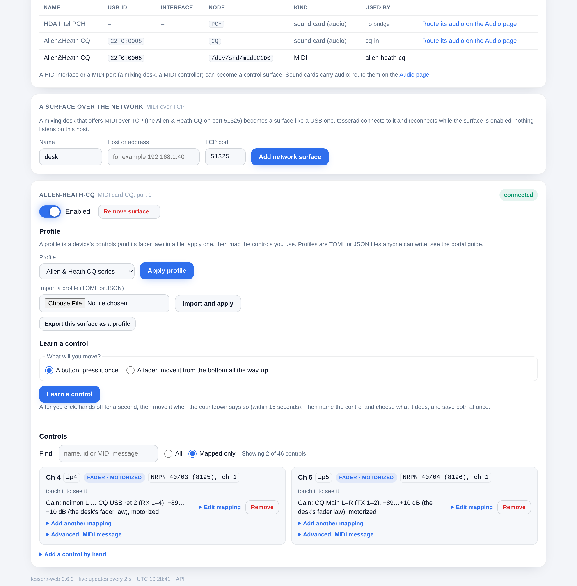

# Surface profiles (provisional 0.x)

A **surface profile** describes a control surface (a mixing desk, a MIDI
controller, a USB mixer with HID controls) in a file anyone can write and
share: which controls it has, how each one is sent (a MIDI message or a HID
report field), its fader law, and what each control is usually for. A
surface built from a profile needs no learning: apply the profile, then map
the controls you use to your channels, speaker volume, router ports,
crosspoints, or another surface's controls.

The format is defined by `tessera_surface::profile` (`SurfaceProfile`).
TOML is the preferred form; JSON with the same keys is accepted too. Every
section of a profile file is read **strictly**: an unknown key anywhere in the
file (top level, `[match]`, `[curves]`, `[[control]]`, `midi`, or
`[[binding]]`) is refused with an error naming the key and file, never silently
ignored.

The tessera package installs this guide as
`/usr/share/doc/tessera/surface-profiles.md`.

## Where profiles come from

* **Built in**: shipped with tessera, for example
  `crates/tessera-surface/profiles/allen-heath-cq.toml` (Allen & Heath CQ
  series over USB MIDI or MIDI over TCP).
* **Installed** on the host: `/usr/share/tessera/surfaces/` (shipped by
  packages), then `/etc/tessera/surfaces.d/` (your own profiles). Every
  `*.toml` and `*.json` file is read; a file that is not valid is reported and
  skipped.
* **Imported in the portal**: on `/surfaces`, a surface's **Import a
  profile** reads an uploaded file, checks it strictly and applies it to that
  surface. Nothing is written on the host: the controls are saved with the
  surface (`SetSurface`), and the portal keeps the profile until it restarts so
  that faders mapped later still take its fader law.
* **Exported from the portal**: **Export this surface as a profile**
  downloads a surface's controls, the fader laws its mappings use and its
  mappings (as suggestions, see below) as TOML. Rename `name` before sharing
  it.

> The portal lists the profiles the daemon reports (built in and
> installed via `Query::SurfaceProfiles`) plus the one imported for a surface.
> MIDI profiles work identically for USB MIDI (`rawmidi`) and MIDI over TCP
> (`tcp_midi`, where Tessera connects out to `host:port`, such as port `51325`
> on an Allen & Heath CQ; Tessera does not expose an inbound MIDI port in 0.6).

## The format

```toml
name = "my-controller"          # identifier: letters, digits, - and _
vendor = "Acme"                 # optional, shown in the portal
model = "Faders 2"              # optional
description = "What it covers"  # optional

[match]                         # how to recognise the device (optional)
midi_card = "Faders2"           # part of the ALSA card id or name, any case
# usb_id = [0x3142, 0x0c33]     # USB vendor and product id (HID devices)

[curves]                        # named fader laws: raw position -> milli-dB
fader = [{ raw = 1, mdb = -60000 }, { raw = 127, mdb = 0 }]

[[control]]
id = "f1"                       # what mappings refer to
label = "Fader 1"               # optional
kind = "fader"                  # button | fader | encoder
max = 127                       # fader: top raw value (optional)
motorized = false               # the device shows values tessera sends back
midi = { kind = "control_change", channel = 1, number = 7 }

[[control]]
id = "m1"
kind = "button"
midi = { kind = "note", channel = 1, number = 60 }

[[binding]]                     # suggestions: what each control is for
control = "f1"
action = "gain"                 # gain | output_gain | host_volume (buttons: mute | output_mute | host_mute)
curve = "fader"                 # faders: a name from [curves]
direction = "tx"                # optional example
channels = [1]                  # optional example

[[binding]]
control = "m1"
action = "mute"
mode = "toggle"                 # buttons: toggle | momentary | push_to_talk
```

### Controls

The same fields as a surface's controls (see [web-portal.md](web-portal.md#control-surfaces)):

| Key | Meaning |
|-----|---------|
| `id` | identifier, unique in the profile |
| `label` | name shown in the portal |
| `kind` | `button`, `fader` or `encoder` |
| `midi` | MIDI sources (`midi` and `tcp_midi`): `{ kind, channel, number }`; `kind` is `control_change` (CC 0–127), `nrpn` (parameter 0–16383 = MSB × 128 + LSB, sent as CC 99/98 then 6/38) or `note` (0–127); `channel` is 1–16 |
| `report_id`, `offset`, `bits` | HID sources: where the field lives in the input report |
| `max` | faders: the largest raw value (default: the field's full range; 127 for CC, 16383 for NRPN) |
| `inverted` | fader: the value grows downwards |
| `active_low` | button: reads 0 while pressed |
| `motorized` | fader: the device moves to (or shows) the value tessera sets; such a fader does not lock the level it drives |

### Fader laws (`[curves]`)

A list of points, ascending `raw`, from raw position to milli-dB (−96 000 to
+12 000), interpolated linearly between points and held beyond the first and
last. Raw 0 is always off. A fader whose mapping names a curve follows
it instead of a dB range and taper: the portal says **Follows the device's
own fader law** and shows the dB at the fader's position.

### Suggested bindings (`[[binding]]`)

What each control is for, without the host's channels: `action` (`mute`,
`gain`, the RX output stage after the local mix: `output_mute`,
`output_gain`, or the host volume: `host_mute`, `host_volume`), `mode` for buttons (`toggle`, `momentary`, `push_to_talk`),
`curve` for faders, and optionally an example `direction` (`rx`/`tx`; the
output actions imply `rx`) and `channels`. The host volume and mute act on no channels, so they take
neither. A profile cannot suggest the router actions (`port_gain`, `port_mute`,
`crosspoint_gain`, `crosspoint_mute`) or `follow`: they name one host's router
ports, crosspoints or surfaces, which a shared file cannot know, so they are
mapped on the host (`/surfaces`, or `SetSurface`). When you add a mapping of a profiled
control in the portal, the form starts from the suggestion (the output stage,
the mode, and the example channels when the host has one device); the fader law
of the suggestion is applied to every level mapping of that fader (including
speaker volume, router port levels, crosspoint gains, and `follow` bindings
configured on `/surfaces` or via `SetSurface`).

## Writing your own profile

To add a MIDI controller or USB HID surface that does not ship a profile yet:

1. **Find its messages or layout.** Either consult the device's MIDI
   implementation chart (CC, NRPN, or Note numbers and channel), or use
   **Learn a control** on `/surfaces` (or `tesseractl surface learn <id>`) to
   capture a few controls, then click **Export this surface as a profile** to
   get a valid starter TOML file.
2. **Edit the TOML.** Set a unique `name`, add `[match]` (`midi_card` for a
   USB MIDI card id/name, or `usb_id = [0xVVVV, 0xPPPP]` for HID), list every
   `[[control]]`, and add `[curves]` if the hardware has a non-linear fader
   law (otherwise leave `curve` out and pick a dB range and taper when
   mapping).
3. **Install or import it.** Drop the file into `/etc/tessera/surfaces.d/` (for
   example `/etc/tessera/surfaces.d/my-controller.toml`) so the daemon lists it
   on `/surfaces`, or upload it directly with **Import a profile** to test it
   immediately.

A minimal 2-fader, 2-button USB MIDI controller profile:

```toml
name = "compact-midi-2"
vendor = "Example"
model = "MiniFader 2"
description = "Two non-motorized CC faders and two Note mute buttons."

[match]
midi_card = "MiniFader"

[[control]]
id = "fader-1"
label = "Fader 1"
kind = "fader"
max = 127
midi = { kind = "control_change", channel = 1, number = 1 }

[[control]]
id = "mute-1"
label = "Mute 1"
kind = "button"
midi = { kind = "note", channel = 1, number = 36 }

[[control]]
id = "fader-2"
label = "Fader 2"
kind = "fader"
max = 127
midi = { kind = "control_change", channel = 1, number = 2 }

[[control]]
id = "mute-2"
label = "Mute 2"
kind = "button"
midi = { kind = "note", channel = 1, number = 37 }

[[binding]]
control = "fader-1"
action = "gain"

[[binding]]
control = "mute-1"
action = "mute"
mode = "toggle"
```

Because `motorized` defaults to `false`, mapping `fader-1` to a channel,
speaker volume, router port, or crosspoint lets the hardware fader own that
level while the controller is connected (the portal shows the slider read-only;
mute still works everywhere).

## Example: Allen & Heath CQ

The built-in profile (excerpt; the full file ships at
`/usr/share/tessera/surfaces/allen-heath-cq.toml` and in the source tree at
`crates/tessera-surface/profiles/allen-heath-cq.toml`). The CQ sends every
change as NRPN on MIDI channel 1 (over USB MIDI or MIDI over TCP on port
`51325`) and accepts the same messages, so its faders follow what tessera sends
back (`motorized = true`). Mutes are states (1 on, 0 off), not presses: a mute
mapping follows the desk's mute key whatever the mode.

```toml
name = "allen-heath-cq"
vendor = "Allen & Heath"
model = "CQ series"

[match]
midi_card = "CQ"

[curves]
fader = [
    { raw = 192, mdb = -89000 }, { raw = 320, mdb = -80000 },
    { raw = 768, mdb = -60000 }, { raw = 1024, mdb = -50000 },
    { raw = 1984, mdb = -40000 }, { raw = 3968, mdb = -30000 },
    { raw = 5952, mdb = -20000 }, { raw = 7936, mdb = -10000 },
    { raw = 10048, mdb = -5000 }, { raw = 12544, mdb = 0 },
    { raw = 14784, mdb = 5000 }, { raw = 16320, mdb = 10000 },
]

[[control]]
id = "ip1"                      # input 1 level to Main LR: NRPN 40/00
label = "Ch 1"
kind = "fader"
max = 16320
motorized = true
midi = { kind = "nrpn", channel = 1, number = 0x2000 }

[[control]]
id = "ip1-mute"                 # input 1 mute: NRPN 00/00
label = "Ch 1 mute"
kind = "button"
midi = { kind = "nrpn", channel = 1, number = 0x0000 }

[[control]]
id = "main-lr"                  # Main LR level: NRPN 4F/00
label = "Main LR"
kind = "fader"
max = 16320
motorized = true
midi = { kind = "nrpn", channel = 1, number = 0x2780 }

[[control]]
id = "main-lr-mute"             # Main LR mute: NRPN 00/44
label = "Main LR mute"
kind = "button"
midi = { kind = "nrpn", channel = 1, number = 0x0044 }

[[binding]]
control = "ip1"
action = "gain"
curve = "fader"

[[binding]]
control = "main-lr"             # the speaker volume ([host_volume])
action = "host_volume"
curve = "fader"

[[binding]]
control = "main-lr-mute"
action = "host_mute"
```

In the portal: add the CQ's USB MIDI port (or add it under **A surface over the
network** on TCP port `51325`) on `/surfaces`, press **Apply profile** (the CQ
profile is offered first when matching the USB card), then map **Main L/R** and
its mute to the speaker volume as the profile suggests (`host_volume` and
`host_mute`, which need `[host_volume]` in the configuration; without it, map
them to the output level and mute of RX 1–2) and input faders 4/5/6 to your
channels. See the full speaker walkthrough in
[the user guide](user-guide.md#worked-example-speaker-appliance-with-an-allen--heath-cq-12t).



## Checks

A profile is refused, with the reason, when:

* any unknown key appears anywhere in the file (including inside `[[control]]`,
  `midi`, `[curves]`, `[match]`, or `[[binding]]`);
* its `name`, a control `id`, or a curve name is not an identifier (letters,
  digits, `-`, `_`), or a control `id` repeats;
* a MIDI channel is not 1–16, or a CC/NRPN/Note number is out of range for its
  kind;
* a curve has fewer than two points, starts at raw 0, is not strictly ascending
  in `raw`, or leaves the gain range (−96 000 to +12 000 milli-dB);
* a binding names an unknown control or curve, uses an action outside
  `mute`/`gain`/`output_mute`/`output_gain`/`host_mute`/`host_volume` (the
  router actions and `follow` are refused: "names one host's router ports,
  crosspoints or surfaces"), binds a button to a level or a fader to a mute,
  sets `direction = "tx"` on an output action, gives the host volume or mute a
  `direction` or `channels` ("remove `channels`: a host volume binding acts on
  the host volume, not on channels"), or gives a curve to a non-fader.

Applying a profile of MIDI messages to a HID surface (or the reverse) is
refused too.
