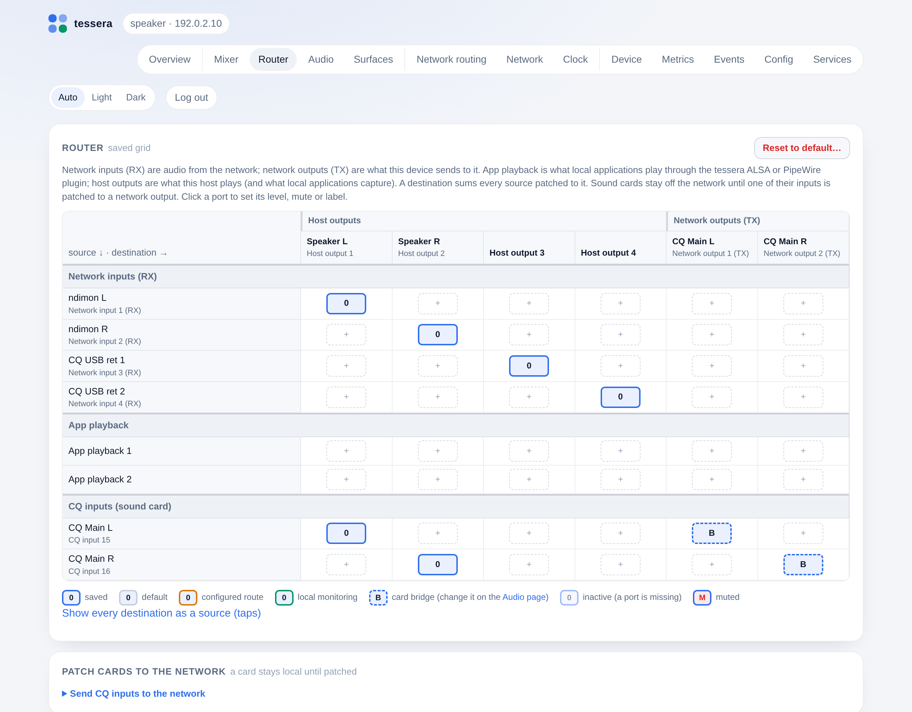
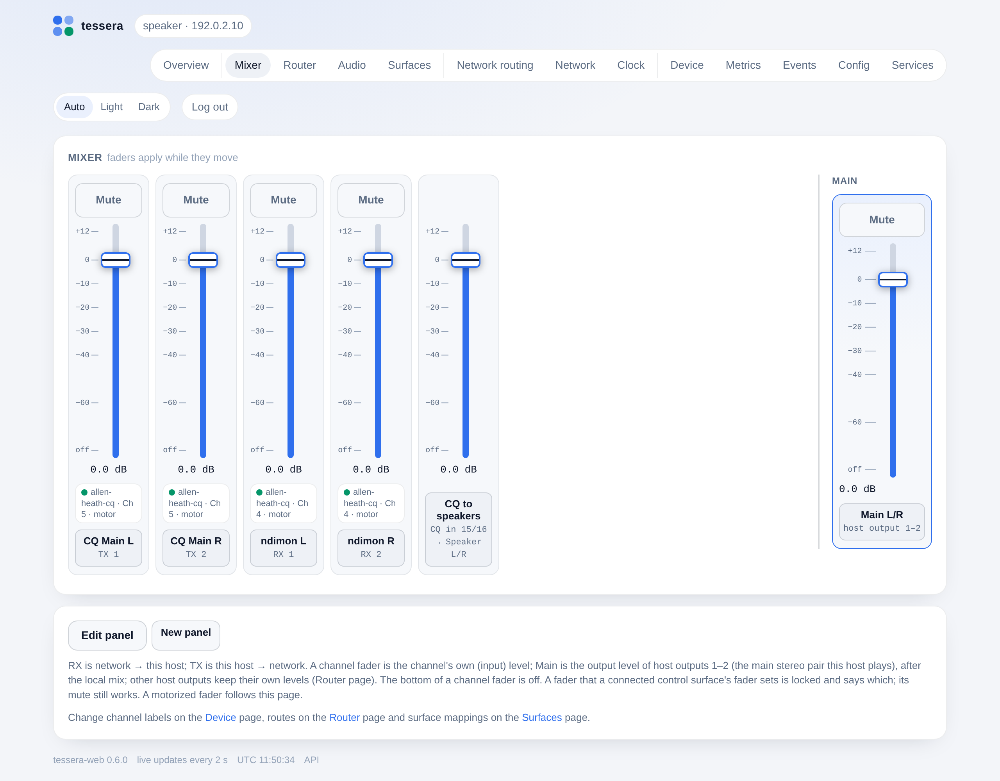

# tessera user guide

tessera makes a Linux machine a device on an audio-over-IP network: it has a
name, receive and transmit channels, a synchronised media clock, and it can be
routed to and from other devices. It is a clean-room, open implementation
(MPL-2.0), targeting interoperability with Dante® (a registered trademark of Audinate Pty
Ltd, which is not affiliated with this project).

> **Read this first: what works today.** This guide describes the packages
> built from the current source tree. `tesserad` runs the PTPv1 clock
> (follower or leader), the media engine with **static flows** (`[[flow]]`,
> provisional), receiver keepalives, mDNS advertisement, the local
> control and audio sockets, and (in builds with the `alsa-bridge` feature)
> the in-daemon sound-card bridge. By default `tesserad` itself does **not**
> implement the vendor's control protocols (routing, device control,
> monitoring): a subscription made with `tesseractl subscribe` is stored but no
> flow is set up from it by the daemon, and audio crosses the network only
> through `[[flow]]` entries. The packages also install and enable a separate
> **Controller compatibility runtime** (`tessera-controller@main`) that serves
> the first logical device's base control ports and hands the flows a controller
> sets up to the daemon as a typed command (section 3, "Controller flows"). An
> administrator can instead enable the daemon's opt-in **native device role**
> (`--native-device`), which serves those ports itself and requests a flow for
> every saved subscription ([interoperability.md](interoperability.md#native-device-role)). Everything
> that concerns the wire (packet format, ports, QoS values, timing defaults,
> protocol identity values) is **provisional** until it has been confirmed
> with external hardware. Compatibility limits: [interoperability.md](interoperability.md).

## 1. What is in the packages

| Package | Contents | Notes |
|---|---|---|
| `tessera` | `tesserad` (daemon), `tesseractl` (control tool), systemd unit, the Controller compatibility runtime and its unit, `tessera` user and `tessera-admin` group, reference configuration, completions and man pages (native builds only), this documentation | needs systemd 253 or newer |
| `tessera-pw` | `tessera-pw`, the PipeWire client, and its systemd **user** unit | depends on `pipewire` and `tessera` |
| `tessera-alsa` | ALSA plugin `pcm.tessera` and its configuration snippet | built by default; left out with `SKIP_ALSA=1` (section 10) |
| `tessera-web` | `tessera-web`, the portal (pages and JSON API), standalone network helper/recovery units and the `tessera-web` user | depends on `tessera`; see section 4b |
| `tessera-dsp` | CamillaDSP and its GUI, the equaliser stage of a network speaker (amd64 and arm64) | depends on the exact versions of `tessera` and `tessera-alsa`, recommends `tessera-web`; see [dsp.md](dsp.md) |

A speaker is normally installed with the add-on bundle, which brings the
right packages and the configuration together ([bundle.md](bundle.md),
[raspberry-pi-speaker.md](raspberry-pi-speaker.md)). The build script targets
`amd64`, `arm64` (Raspberry Pi 4/5 with a 64-bit OS) and `armhf`; see section 10.
`tessera-dsp` is not built for `armhf`.

## 2. Install

```sh
sudo apt install ./tessera_<version>_<arch>.deb ./tessera-pw_<version>_<arch>.deb
```

(`dpkg -i` works too; `apt install ./file.deb` also pulls in dependencies.)

What installing does, and does not do:

* creates the system user `tessera` and the groups `tessera` and
  `tessera-admin` (through `systemd-sysusers`, from
  `/usr/lib/sysusers.d/tessera.conf`);
* creates `/etc/tessera`, `/etc/tessera/config.d`, `/var/lib/tessera`
  (mode 0750, owner `tessera`) and `/run/tessera` (`systemd-tmpfiles`);
* **enables** `tesserad.service` so that it starts at boot, but **does not
  start it**: the daemon will own audio devices on your network, so you start
  it when you have looked at the configuration;
* enables the Controller compatibility runtime `tessera-controller@main.service`
  with the daemon: it starts and stops with `tesserad` (it is `PartOf` it) and is
  not started by the installation either;
* does not enable `tessera-pw` (it is a per-user service, see section 6).

A speaker (a Raspberry Pi with a DAC, a mini-PC with an amplifier) is better
installed with the add-on bundle than with `apt install` by hand: see
[bundle.md](bundle.md) and [raspberry-pi-speaker.md](raspberry-pi-speaker.md).

Start it, and check it:

```sh
sudo systemctl start tesserad
systemctl status tesserad
```

```
● tesserad.service - tessera audio-over-IP daemon
     Loaded: loaded (/usr/lib/systemd/system/tesserad.service; enabled; preset: enabled)
     Active: active (running) since ..
     Status: "serving 1 device(s)"
```

### Who may do what: the two groups

* Members of group **`tessera`** may talk to the daemon's sockets: read the
  status, attach audio clients (PipeWire, ALSA).
* Members of group **`tessera-admin`** (name configurable, `[daemon]
  admin_group`) may also **change** things (`tesseractl set-*`, `config
  reload`). `root` always may.
* An administrator must therefore be in **both** groups: the socket's
  permissions (0660, group `tessera`) are checked by the kernel before the
  daemon sees the request.

```sh
sudo usermod -aG tessera,tessera-admin alice     # an administrator
sudo usermod -aG tessera bob                     # may use audio, read status
```

Group changes apply to new login sessions: log out and in again.

Removing the packages never deletes the user or the groups (see section 9).

## 3. Configuration

Files:

| File | Owner | Purpose |
|---|---|---|
| `/etc/tessera/config.toml` | the package (a conffile) | the reference: every key, commented out at its default, with what it does and why. Nothing in it is active; leave it as shipped |
| `/etc/tessera/config.d/*.toml` | you, or other packages | your configuration: drop-ins applied after `config.toml` in file-name order |
| `/var/lib/tessera/state.toml` | the daemon | values changed at run time (by `tesseractl` or network controllers), including the controller flow set. Do not edit while the daemon runs |
| `/etc/tessera/web.toml`, `/etc/tessera/web.d/*.toml` | the package, you | the portal's configuration: `web.toml` is a package file with every key commented out, your settings go in `web.d/` (read after it, in name order, a later file wins) |
| `/etc/tessera/trusted-release-keys` | you | public keys that vouch for add-on bundles ([bundle.md](bundle.md#trusted-release-keys)); absent by default |

`tesserad --print-default-config` prints the reference of the installed version, and
`/usr/share/doc/tessera/examples/config.toml` is a copy of it (absent on images that strip `/usr/share/doc`, such as some containers).
`/usr/share/doc/tessera/configuration.md` is the prose reference
(provisional where it concerns the wire). An **empty configuration is valid**: one device named
after the host, 2 receive and 2 transmit channels, 48 kHz, 24 bit, 4 ms
latency (10 ms on ARM).

A small configuration (copy the lines you want from the reference into a file in `config.d/`):

```toml
# /etc/tessera/config.d/50-site.toml
[daemon]
admin_group = "tessera-admin"

[clock]
role = "follower"                 # follower | leader | auto
locked = ["role"]                 # nobody can change the role at run time

[[device]]
id = "main"                       # local key used by `tesseractl --device`
name = "studio-pc"                # at most 31 bytes
rx_channels = 4
tx_channels = 2
sample_rate = 48000
rx_channel_labels = { 1 = "Vox", 2 = "Gtr" }
locked = ["sample_rate"]
```

A drop-in changes single keys without touching the base file:

```toml
# /etc/tessera/config.d/60-latency.toml
[[device]]
id = "main"                       # same id: merged into the device above
latency_us = 6000
```

The rules (full detail in `configuration.md`):

* Tables merge key by key; scalars and arrays are replaced.
* `[[device]]` entries merge by `id`; a new `id` adds a device; a drop-in
  cannot delete a device.
* `locked` lists combine across files: a drop-in can add a lock, never remove
  one.
* **Precedence**: built-in default, then `config.toml` plus drop-ins, then
  `state.toml` (only if within the configured bounds), then run-time commands
  (which are validated and written to `state.toml`), then `locked`, and above
  everything a `tesserad` command-line option.

### Daemon settings

Everything the daemon can be tuned with is a configuration key: control and
audio socket limits, timeouts, the engine's batch sizes and tick, receiver
keepalives, the bridge reopen back-off, real-time scheduling, PTP and mDNS
switches. `tesserad --print-default-config` prints every key, commented out at
its default, with what it does and why (`tesserad --print-default-config
| less`; it reads no file). Put your changes in a drop-in:

```toml
# /etc/tessera/config.d/40-limits.toml
[control]
max_connections = 64

[audio]
ring_budget_mib = 128
```

Each key says when a change takes effect. Most apply on a reload (new control
connections and new audio clients get the new limits); a few size real-time
structures or sockets and need a service restart (for example `[engine]`, the
socket mode and group, `[daemon] realtime`, `[clock] enabled`, `[discovery]
enabled`; `configuration.md` lists them all).
After a reload the daemon logs every such key it cannot apply yet, and
`tesseractl status` shows them as a warning until `systemctl restart
tesserad`. The `tesserad` command-line options still exist and override the
files (each one is logged at start, and a reload never changes it), but under
systemd the daemon runs without options: prefer drop-ins.

### Locked keys

A key listed in a device's `locked` (or in `[clock] locked`) is **pinned by
the configuration**: the file's value always wins, and an attempt to change it
at run time is refused with an error:

```
$ tesseractl set-rate 96000
tesseractl: sample_rate is locked by the configuration
$ tesseractl clock set-role leader
tesseractl: role is locked by the configuration
```

Lockable device keys: `name`, `sample_rate`, `encoding`, `latency`,
`rx_channels`, `tx_channels`, `rx_channel_labels`, `tx_channel_labels`; clock keys: `role`, `priority`; network key: `primary`. A
lock does not stop a *later drop-in* from setting another value: it only
blocks run-time changes. Adding a lock clears the stored run-time value for
that key.

### Check before you reload

```sh
tesseractl config check            # validates /etc/tessera without touching the daemon
sudo systemctl reload tesserad     # asks the daemon to re-read the files
```

```
$ tesseractl config check
configuration OK (2 file(s), 0 warning(s))
```

`systemctl reload` (SIGHUP) applies whatever the files say. `tesseractl config
reload` asks first when the edited files would restart a device (channel
counts, interfaces, flows, bridges): it prints what would restart and asks
y/N on a terminal; without a terminal it says there is none to ask on,
changes nothing and exits 1. `tesseractl --yes config reload` applies it
without asking.

A reload that the daemon refuses leaves the **old configuration running**;
the reason appears in the unit status. Note that `systemctl reload` itself
may still return success: always look at the status text:

```
$ systemctl status tesserad
     Status: "reload failed (still running the old configuration): invalid config: error: syntax error at line 1, column 6: key with no value, expected `=` (in /etc/tessera/config.d/60-broken.toml)"
```

**Device names.** A device without `name` is named after the host. Once a
second device exists, the default becomes `<host>-<id>`, which renames the
first one on the network. Give every device an explicit `name`.

## 4. `tesseractl` cookbook

All commands talk to `/run/tessera/control.sock` (`--socket` or
`TESSERA_SOCKET` to change it). Reading needs group `tessera`; changing needs
`tessera-admin` too. `--json` gives machine-readable output; `--device KEY`
(or `TESSERA_DEVICE`) picks a device when there is more than one. Exit codes:
0 ok, 1 error, 2 usage, 3 cannot connect, 4 permission denied.

The following examples use placeholder host names and documentation addresses.
Exact human-readable output may change; use `--json` for integrations.

**Status**

```
$ tesseractl status
tessera 0.6.0

DEVICE  NAME       RATE      BITS  LATENCY  RX  TX  LOCKED       ACCESS
main    studio-pc  48000 Hz  24    6000 us  4   2   sample_rate  open

Primary interface: enp3s0 (automatic)

Clock settings: role follower, priority 128 (locked: role)
```

The section order is: devices, subscriptions, primary interface, clock
settings, then `Clocks`, `Bridges` and `Warnings` tables when they have
content.

**Rename the device, relabel channels**

```
$ tesseractl set-name studio-a
main: name set to "studio-a"
$ tesseractl set-label rx 3 "Room mic"
main: rx channel 3 label set to "Room mic"
$ tesseractl set-label rx 3 --reset
main: rx channel 3 label reset
```

**Audio format and latency** (`set-rate`, `set-encoding`, `set-latency`)

```
$ tesseractl set-latency 8000
main: latency set to 8000 us
$ tesseractl set-encoding 16
main: encoding set to 16 bit
$ tesseractl set-latency 50
tesseractl: invalid latency: 50 us is outside the allowed range [1000, 40000]
```

**Subscriptions.** Route a local receive channel from a named transmit
channel of another device (kept by name even if the device is not there yet):

```
$ tesseractl subscribe 2 "Out 2" stagebox-a
main: rx 2 subscribed to Out 2 @ stagebox-a
$ tesseractl status
..
Subscriptions
DEVICE  RX  FROM                STATE        LATENCY
main    2   Out 2 @ stagebox-a  in progress  -

Primary interface: enp3s0 (automatic)
..
$ tesseractl unsubscribe 2
main: rx 2 unsubscribed
```

(The subscription above is "in progress" because no flow carries rx channel 2 yet.
Without the native device role, `tesserad` stores it, by name, but does not implement
the flow-control protocol that would set it up: audio is carried by `[[flow]]` entries
in the configuration (see `configuration.md`, "Static flows") or by the flows the
compatibility runtime submits. With the native device role, the daemon requests the
flow from `stagebox-a` itself. When a rx flow carries the channel, the state becomes
"receiving" while its packets arrive and "no media" about 2 to 3 s after they stop.
For a reviewed change with lock checks use the portal's Routing page or
`tesseractl routing`; see `interoperability.md`.)

**Controller flows.** The flows that the Controller compatibility runtime (or you)
sets up are a set of their own, kept in `state.toml` next to the `[[flow]]` entries
of your configuration files. They replace each other as a whole, and they survive a
restart of the daemon:

```sh
tesseractl flows show                          # the flows in effect, with their counters
tesseractl flows set controller-flows.toml     # a file with only [[flow]] entries
tesseractl --yes flows clear                   # store an explicit empty set
```

Changes that restart a device ask first (`--yes` for scripts). A host that owns the
flows, such as an NDIMon appliance, writes `[control] locked = ["flows"]` and every
change is then refused. An old `/etc/tessera/config.d/90-probe-flows.toml` is still read
with a warning until a set has been stored; the file is deprecated (still read in 0.5.0;
its removal is deferred).
Reference: `configuration.md`, "Controller flows and host ownership".

**Clock**

```
$ tesseractl clock show
Clock settings: role follower, priority 128 (locked: role)
No clocks.
$ tesseractl clock set-priority 20
clock priority set to 20
```

`clock set-role follower|leader|auto` likewise. PTPv1 has no priority field:
the priority is mapped onto what a leader-capable node advertises by a
provisional, tessera-only rule (`configuration.md`, "Priority mapping").

**Network interface**

By default the primary interface is chosen automatically: the first wired
interface with a link and an IPv4 address. To use another one, select it; the
choice is kept across restarts:

```
$ tesseractl network show
Primary interface: enp3s0 (automatic)

INTERFACE  MAC                IPV4        LINK  TYPE   USABLE
enp3s0 *   02:00:00:00:00:01  192.0.2.20  up    wired  yes
wlan0      02:00:00:00:00:02  192.0.2.21  up    wi-fi  no: Wi-Fi interface and `allow_wireless` is off
$ tesseractl network primary enp4s0
primary interface selected: enp4s0
$ tesseractl network primary default
primary interface selection cleared
```

If the selected interface is missing later (unplugged, not up yet after a
reboot), the device keeps running on the automatic or configured choice,
`network show` says `fallback` and why, and the selection takes over again
when the interface returns. `[network] locked = ["primary"]` in the
configuration forbids runtime selection.

**Watch changes** (every client's changes, as they happen; `--count N` and
`--for SECONDS` end it, Ctrl-C otherwise):

```
$ tesseractl watch
main: renamed to "studio-b" (cli uid 1000)
main: tx channel 1 label is now "Main L" (cli uid 1000)
main: subscription rx 2 <- Out 2 @ stagebox-a: in progress
$ tesseractl --json watch --count 1
{"event":{"device_renamed":{"device":"main","name":"studio-c","origin":{"cli":{"uid":1000}}}}}
```

**Counters**

```
$ tesseractl metrics
COUNTER                             VALUE
daemon.uptime_ms                    983
daemon.control_connections          1
..
```

(Abridged.) The table continues with the other `daemon.*` counters, the
`audio.*` and `engine.*` counters, then a `Flows` table
(one row per `[[flow]]`), `Bridges` and `Clocks`. Some per-flow counters,
for example the receiver keepalive counters `keepalives_sent` and
`keepalive_failures`, are only in `tesseractl --json metrics`.

**Configuration views**

```sh
tesseractl config show                     # merged files (default /etc/tessera)
tesseractl config show --provenance        # ... and which file set each key
tesseractl config show --effective         # what the running daemon uses (files + stored state)
tesseractl config check --config-dir DIR   # validate another directory
```

**When the daemon is not running**

```
$ tesseractl status
tesseractl: cannot connect to /run/tessera/control.sock: No such file or directory
is tesserad running? use --socket or TESSERA_SOCKET if it listens elsewhere
(exit 3)
```

**Completions and manual pages** are installed for bash, zsh and fish
(`tesseractl completions SHELL` prints them), plus `man tesseractl` and
`man tesserad` (packages built natively; a cross build has none).

## 4b. Web portal (`tessera-web`)

The portal shows the device in a browser and changes what `tesseractl` can:
the signal path (network, flows, device, audio clients, highlighted while
audio moves), the **Mixer** (`/mixer`) with saved mixing-desk panels, the
**Router** (`/router`) for local-to-network crosspoints and port levels,
**Audio** (`/audio`) for sound-card bridges and local monitoring, **Surfaces**
(`/surfaces`) for USB HID, USB MIDI and MIDI-over-TCP control surfaces,
**Network routing** (`/routing`) for inter-device connections, the network
interface and its selection, device settings (name, rate, encoding, latency,
levels and mute, labels), subscriptions, the clock, metrics, recent events and
the configuration in effect. It runs as its own service and talks to the daemon
through the control socket. Pages are server-rendered with a narrow live-update
script; the same daemon data is available as JSON under `/api/v1/`. Standalone
OS networking uses the separate privileged `tessera-network` helper and a
recoverable Network editor. Receiver keepalive counters are only in JSON
(`/api/v1/metrics`). Reference: [web-portal.md](web-portal.md).

```sh
sudo apt install ./tessera-web_*.deb          # a fresh install starts the portal with the password "tessera"
sudo tessera-web set-password                 # replace it; every page needs a password
sudo usermod -aG tessera-admin tessera-web    # only if the portal may change settings
sudo systemctl enable --now tessera-web
```

Put your site settings in `/etc/tessera/web.d/*.toml`; they are read after
`web.toml`. An upgrade keeps an existing password and restarts a running portal.
On a speaker the portal also controls the services, the volume and the EQ engine
(`web-portal.md`, "Appliance mode"; `dsp.md`).

By default it answers on `http://127.0.0.1:8090` only. From another machine,
use an SSH tunnel (`ssh -L 8090:127.0.0.1:8090 box`) or put a TLS reverse
proxy in front and set `cookie_secure = true` (the proxy must pass the
original `Host` header through: the portal refuses a form whose `Origin` does
not match it). Setting
`listen = "0.0.0.0:8090"` in `/etc/tessera/web.toml` makes it reachable on
the network over plain HTTP: the password and the session cookie then cross
the network unencrypted, so do it only on a trusted, dedicated network.

Without the admin group the portal is read-only and says so when a change is
refused. The daemon records portal changes as coming from the portal's user;
the portal's log (`journalctl -u tessera-web`) names the session.

API in short (log in first; send the CSRF token it returns with every change):

```
POST   /api/v1/session     {"password": "..."}  -> {"csrf": "..."} and a cookie
GET    /api/v1/status      GET /api/v1/metrics   GET /api/v1/config
GET    /api/v1/devices/{key}
POST   /api/v1/commands    a command as JSON, e.g. {"set_primary_interface":{"interface":"eth1"}}
                           header X-CSRF-Token: <csrf>
GET    /api/v1/events      Server-Sent Events: "event" (JSON) and "resync"
DELETE /api/v1/session     (with X-CSRF-Token)
```

## 4c. Host router, levels, control surfaces and mixer panels

Tessera is an audio routing device; network audio interoperable with Dante® is
one of its capabilities. Two layers keep local hardware cleanly separated from
what the network sees:

* **Network channels.** The host exposes one logical network device by default
  (`main`). Its RX (network → this host) and TX (this host → network) channels
  are what network controllers see, nothing else.
* **Local I/O.** Sound-card inputs and outputs (opened by card bridges), what
  local applications play and capture, and the speaker output stay local until
  a crosspoint patches them to or from a network channel.

The **host router** (`/router`, `tesseractl router …`) sits between the two
layers. Sources are rows (network RX, application outputs, card inputs, and
taps of destinations) and destinations are columns (host/speaker outputs,
network TX, card outputs). Every destination sums every crosspoint patched into
it, each with its own gain and mute. Until you edit the grid, the **default
grid** applies (RX *n* → host out *n*, app *n* → TX *n*, local monitoring, and
any `[[route]]` entries in `/etc/tessera/config.d/`), which preserves 0.5
behaviour. The first edit saves the default grid and then applies your change;
**Reset to default** (`tesseractl router reset`) returns to the default grid.

**Levels.** Every signal point has a level and a mute:

| Stage | What it controls | CLI |
|---|---|---|
| Channel input | A network RX or TX channel's own level (RX before local mixing) | `tesseractl gain` / `mute` / `unmute` |
| Output stage | An RX channel's host output (`host_out`), after the mix, like a master | `tesseractl output-gain` / `output-mute` |
| Router port & crosspoint | Any port level (`card_in`, `card_out`, `app_out`, …) or crosspoint gain | `tesseractl router port-gain\|port-mute\|gain\|mute` |
| Host (speaker) volume | The amplifier's ALSA mixer control (`[host_volume]` in `config.d/`) | `tesseractl volume show\|set\|mute` |

On a speaker installed with `--profile speaker`, the installer writes
`/etc/tessera/config.d/60-host-volume.toml` so `tesserad` owns the amplifier's
ALSA mixer control directly. On first start the portal hands its previously
saved `volume.json` value over once (leaving `[appliance.volume]` and
`volume.json` in place so a rollback to an older daemon still works).

**Control surfaces.** `/surfaces` connects out to USB HID interfaces
(`/dev/hidraw*`), USB MIDI ports (ALSA rawmidi `/dev/snd/midi*`), and desks
that offer raw MIDI over TCP (such as an Allen & Heath CQ on TCP port `51325`).
Tessera connects out only and never listens: exposing its own MIDI port to be
controlled by other software is not in 0.6. Shipped profiles live in
`/usr/share/tessera/surfaces/` and your own in `/etc/tessera/surfaces.d/`
([surface-profiles.md](surface-profiles.md)); unknown keys in profile files are
refused. Controls without a profile can be captured with **Learn a control**
(`tesseractl surface learn`). Values remain unknown ("touch it to see it")
until the device reports them (or Tessera moves a motorized fader there).
While a surface is connected, a **non-motorized fader** owns the level it
drives (channel gain, host volume, router port level, or crosspoint gain — the
portal shows it read-only); **mute is never owned**, and **motorized faders**
own nothing and follow changes made elsewhere.

**Mixer panels.** `/mixer` opens a desk of channel strips (and a horizontal
strip layout on phones). Until you save a panel, it shows a default desk of
the channels in use plus Main L/R. Open `/mixer/edit` to build your own panels
with any number of faders or buttons targeting channels, router ports,
crosspoints, or host volume, group and reorder strips, mark a master strip, and
link any strip to a hardware control (the link is derived from the surface's
binding).

### Worked example: speaker appliance with an Allen & Heath CQ-12T

This setup connects an Allen & Heath CQ-12T mixer by USB (or Ethernet for MIDI
over TCP) to a Tessera speaker appliance whose network device `main` plays
network audio from `ndimon` (RX 1–2) through CamillaDSP to the speaker amp.

**Goal:**
1. Capture the CQ's Main L/R mix (USB channels 15–16) onto network TX 1–2 so
   other devices can receive it, **and** mix it directly into the speakers
   (`Speaker L/R`) with no network hop.
2. Send two network returns (`CQ USB ret 1–2` on RX 3–4) to the CQ.
3. Drive the speaker volume from the CQ's Main L/R fader, and control `ndimon`
   (RX 1–2), `CQ Main` (TX 1–2), and `CQ USB ret` (RX 3–4) from CQ channel
   faders 4, 5, and 6 using the CQ's own fader law.

**Steps:**

1. **Match sample rates.** Ensure the CQ and Tessera device run at the same
   sample rate (48 kHz or 96 kHz; check `/audio` or `tesseractl status`).
2. **Grow the device channels** if needed (4 RX, 2 TX):

   ```sh
   tesseractl -d main set-channels --rx 4 --tx 2
   tesseractl -d main set-label rx 1 "ndimon L"
   tesseractl -d main set-label rx 2 "ndimon R"
   tesseractl -d main set-label rx 3 "CQ USB ret 1"
   tesseractl -d main set-label rx 4 "CQ USB ret 2"
   ```

3. **Bridge the CQ's Main L/R (USB 15–16) onto TX 1–2** on `/audio` (setting
   **First card input** to `15`, **Channels** to `2`, **Low latency** on, and
   labels `CQ Main L` / `CQ Main R`), or from the CLI:

   ```sh
   tesseractl -d main bridge add cq-in --card hw:CARD=CQ,DEV=0 \
     --direction capture --card-first 15 --first 1 --channels 2 --low-latency
   tesseractl -d main set-label tx 1 "CQ Main L"
   tesseractl -d main set-label tx 2 "CQ Main R"
   ```

   *(If you want the CQ to stay off the network until explicitly patched, check
   **For local routing only** on `/audio` instead and use **Send CQ inputs to
   the network** on `/router` later.)*

4. **Mix CQ inputs 15–16 into the speakers locally** on `/router` (click **+**
   at `CQ in 15` × `Speaker L` and `CQ in 16` × `Speaker R`, and optionally
   rename `host out 1/2` to `Speaker L` / `Speaker R` via their port headers),
   or from the CLI:

   ```sh
   tesseractl router patch in:hw:CARD=CQ,DEV=0:15 host:main:1
   tesseractl router patch in:hw:CARD=CQ,DEV=0:16 host:main:2
   ```

   The CQ's Main L/R now plays out of the speakers alongside `ndimon L/R`
   directly inside `tesserad` without waiting for a network flow, while the
   bridge-implied **B** cells feed `CQ Main L/R` to the network.

   

5. **Add the CQ as a control surface** on `/surfaces`:
   - Over USB: click **Add as surface** next to the `Allen&Heath CQ` MIDI port
     (`/dev/snd/midiC*D*`).
   - Over the network (Ethernet): under **A surface over the network**, enter
     name `cq`, the desk's IP address, and TCP port `51325` (or run
     `tesseractl surface tcp-midi cq 192.0.2.40`).
   - Click **Apply profile** and choose **Allen & Heath CQ series**. All 46
     NRPN controls and the CQ's 12-point fader law (raw `192` = −89 dB,
     `12544` = 0 dB, `16320` = +10 dB; raw `0` = off) are added at once.
     Because the CQ's faders are marked `motorized = true`, they never lock
     levels in the portal and follow changes made in the browser or CLI.

6. **Map the CQ faders** on `/surfaces` (each fader automatically uses the CQ's
   fader law from the profile):
   - **Main LR (`main-lr`)** → **The speaker volume** (`host_volume`, when
     `[host_volume]` is configured in `config.d/60-host-volume.toml`; or
     **Output level** of `main` RX 1–2 if using the output stage instead). Map
     **Main LR mute** to the matching mute.
   - **Ch 4 (`ip4`)** → **Channels**: `main` RX 1–2 (`ndimon L/R`), input level.
   - **Ch 5 (`ip5`)** → **Channels**: `main` TX 1–2 (`CQ Main L/R`), input level.
   - **Ch 6 (`ip6`)** → **Channels**: `main` RX 3–4 (`CQ USB ret 1–2`), input
     level.

7. **Build a custom Mixer panel** (optional): open `/mixer`, click **Edit
   panel** → **Save the default panel and edit it**, and add a **Crosspoint
   gain** strip (`CQ to speakers`) targeting `CQ in 15 → Speaker L` and
   `CQ in 16 → Speaker R` so you can also balance the CQ's local feed from a
   browser or phone.

   

### To add any DAC or USB audio interface

1. Plug in the DAC or interface. `tesserad` runs in group `audio` out of the
   box, so it detects the card automatically on `/audio` (and `tesseractl
   surfaces`). If you added a custom PCM in `/etc/asound.conf`, restart
   `tesserad` first.
2. Check that the card supports the Tessera device's sample rate (listed on
   `/audio`). If not, change the device's rate on `/devices` (`tesseractl
   set-rate`).
3. On `/audio`, open **Send its inputs to the network** or **Play network audio
   on its outputs**:
   - To keep the card local (for example, to mix a DAC input into the speakers
     without exposing new network TX channels), tick **For local routing only**
     (`local_only = true`).
   - To pick a slice of a multi-channel interface, set **First card input /
     output** (`card_first_channel`, or `--card-first` in `tesseractl bridge
     add`).
   - Tick **Low latency** for 96-frame card periods (2 ms at 48 kHz) when low
     round-trip delay matters.
4. On `/router`, patch `card_in` sources to `host_out` (speakers/apps),
   `card_out`, or `network_tx` (or use **Send `<card>` inputs to the network**
   / **Feed `<card>` outputs from the network** to add channels and patch in
   one step).

### To add any MIDI controller

1. Connect a USB MIDI controller (it appears under **Devices on this host** on
   `/surfaces`), or add a network desk under **A surface over the network**
   (`tesseractl surface tcp-midi <name> <host> [port]`).
2. Click **Add as surface**.
3. If a profile matches your controller (built in, in
   `/usr/share/tessera/surfaces/`, or dropped into `/etc/tessera/surfaces.d/`),
   click **Apply profile**. Otherwise click **Learn a control**, keep your
   hands off for a second, and move a fader from bottom to top (or press a
   button once) to capture its MIDI message and map it in one form.
4. Choose what each control drives: channel gain/mute, output stage, speaker
   volume (`host_volume`/`host_mute`), router port or crosspoint level/mute, or
   **Follow** another surface's control. Non-motorized faders take ownership of
   the level they control while connected (mute always stays usable from the
   portal and CLI).
5. Optionally open `/mixer/edit` and link strips to the controller's controls so
   the web desk shows badges for every hardware binding. To save or share your
   setup, click **Export this surface as a profile** on `/surfaces` (or export
   the full surface JSON with `tesseractl surfaces --json` and reapply later
   with `tesseractl surface set --file`).

## 5. Discovery

With `[discovery] advertise_devices = true` (the default) the daemon announces each logical
device on the local network with multicast DNS (records for the device's
control services and one per transmit channel), updates the records on a
rename or a label change, and withdraws them when it stops. The
`[discovery] mdns` setting chooses `auto` (use the system `avahi-daemon` when
it is on the bus, otherwise a built-in responder; never both), `avahi`,
`builtin` or `off`. That is why the package **recommends `avahi-daemon`**.

**Status:** advertising is **on by default** (`advertise_devices = true`), because
the packages also enable the Controller compatibility runtime. Device browsing
(`[discovery] browse_devices`) is also **on by default** (`true`) so the
portal's **Network routing** page and `tesseractl routing` can list devices on
the segment; set `browse_devices = false` in `/etc/tessera/config.d/` to opt
out. The records name
control ports (ARC 4440, CMC 8800, flow control 4455, plus 10 per further
device); the runtime serves the first logical device's base ports, or `tesserad`
itself with the native device role. A controller that finds a device where
neither is running, or a further logical device, cannot talk to it and shows it
greyed out.
The daemon warns once per advertised port that no socket is bound to (see
`troubleshooting.md`); set `advertise_devices = false` to advertise nothing.
The record contents follow a
provisional specification. Multicast DNS must be allowed between the devices
(UDP 5353 on the media network).

## 6. Audio clients

### PipeWire (`tessera-pw`)

`tessera-pw` is a per-user service. For each device of the daemon it creates
a PipeWire **source** (the device's receive channels) and a **sink** (its
transmit channels), named with the prefix `tessera`, driven by the media
clock. Its graph driver priority is low (500): a hardware sound card, when
one is linked, drives the graph and the nodes follow it through a
resampler; otherwise the network clock drives.

Set-up, as the user who runs PipeWire:

```sh
sudo usermod -aG tessera "$USER"          # then log out and in
systemctl --user enable --now tessera-pw.service
journalctl --user -u tessera-pw -f
```

It is **not enabled automatically** by the package, because enabling it
attaches the service to that user's PipeWire. Headless machines: `sudo
loginctl enable-linger USER` so the user session (and PipeWire) start at
boot. The unit asks for real-time scheduling and locked memory with
`LimitRTPRIO=95` / `LimitMEMLOCK=infinity`; without them the client runs at
normal priority and logs a warning (see `rt-tuning.md`).

Look at the nodes with `wpctl status` or `pw-cli ls Node` and connect them
as any other nodes (qpwgraph, Helvum, `pw-link`). Options (`--device KEY`
to expose only some devices, `--period`, `--resampler`, `--rt-priority`) are
in `man tessera-pw` and `tessera-pw --help`; to use them, add a drop-in:

```sh
systemctl --user edit tessera-pw.service
# [Service]
# ExecStart=
# ExecStart=/usr/bin/tessera-pw --audio-socket /run/tessera/audio.sock --control-socket /run/tessera/control.sock --period 128
```

`tessera-pw` survives a `tesserad` restart: the nodes stay (silent) and it
reconnects with back-off. It exits, and systemd restarts it, when PipeWire
goes away.

### ALSA (`tessera-alsa`)

The ALSA plugin provides a PCM called `tessera`; applications talk to the
same audio socket as `tessera-pw`, with the media clock as the plugin's
clock (no resampler in the plugin). Install the package, make the user a
member of group `tessera`, and use it like any ALSA device:

```sh
aplay -D tessera some.wav
```

The package ships its configuration at `/etc/alsa/conf.d/60-tessera.conf`
(a link to `/usr/share/alsa/alsa.conf.d/60-tessera.conf`). The file is the
commented sample of the source tree
(`crates/tessera-backend-alsa/dist/alsa.conf.d/50-tessera.conf`): `pcm.tessera`
with every option at its default (the daemon's default device, 2 channels from
channel 1, the device's rate) and a `tessera_plug` PCM. For other sample formats,
rates or mmap access open `plug:tessera` or `tessera_plug`.
Options, formats and the poll behaviour are in `audio-backends.md`.

`[backends] enabled = [...]` (default `["pipewire", "alsa"]`) is meant to
list the clients allowed to attach. In the current daemon it only
decides whether `audio.sock` is opened at all when `tesserad` runs with
`--audio-socket auto` (the default): an empty list means no audio socket.
Clients are not filtered by kind.

### Bridging a sound card (in-daemon ALSA bridge)

On a headless speaker (a Raspberry Pi with a DAC hat) or a host with a USB
mixer or audio interface, the daemon can drive the sound card itself: no
PipeWire, no `arecord | ...` pipes. A bridge connects a card (or a contiguous
slice of its channels, starting at `card_first_channel`, for example USB
channels 15–16 of an Allen & Heath CQ) either to a device's network channels or
to the host router only (`local_only = true`, staying off the network until
patched). Bridges can be added at run time on `/audio` or with `tesseractl
bridge add`, or declared in `/etc/tessera/config.d/` as `[[bridge]]` entries.
The card's clock is independent of the network's, and the bridge absorbs the
difference with a resampler and a slow PI loop (reference:
[configuration.md](configuration.md#hardware-card-bridges-bridge)). The card
must support the Tessera device's sample rate (drift is compensated, not
nominal rate conversion), and a new PCM added to `/etc/asound.conf` requires a
`tesserad` restart. The `speaker` profile of the add-on bundle does **not** use
a playback bridge for the speaker DAC unless installed with `--no-dsp`: by
default CamillaDSP owns the speaker card and reads `pcm.tessera`, and a card
has one owner ([dsp.md](dsp.md)).

The bridge is a build option: `tesserad` must be built with the cargo
feature `alsa-bridge` (it links libasound; needs `libasound2-dev` and
`pkg-config`). The packages have it only when built with
`TESSERA_DAEMON_FEATURES=alsa-bridge` (section 10); the default package build
leaves it out.

```sh
cargo build --release -p tesserad --features alsa-bridge
TESSERA_DAEMON_FEATURES=alsa-bridge cargo xtask build-deb    # packages with the bridge
```

A `tesserad` without it refuses a configuration with `[[bridge]]` and says
so. The shipped `tesserad.service` unit runs with `SupplementaryGroups=audio`
so user `tessera` can open `/dev/snd/*` cards and MIDI ports without a manual
unit drop-in.

**Straight to the DAC** (no DSP stage):

```toml
[[bridge]]
name = "speaker"
device = "main"
alsa_pcm = "hw:CARD=<card>,DEV=0"  # your DAC: `aplay -L`
direction = "playback"          # the device's RX channels 1 and 2
channels = 2
time_constant_s = 30            # nothing else servos this card: a faster loop is fine
```

**Pi + CamillaDSP through a Loopback.** The bridge plays into one end of an
`snd-aloop` cable; CamillaDSP reads the other end, runs its EQ and plays to
the DAC, and keeps the cable in step with the DAC by trimming the
Loopback's `PCM Rate Shift` (its rate adjustment, `enable_rate_adjust`, with
the Loopback as capture device). There are then two loops in series, and
they must not fight: **keep the bridge's time constant at least ten times
CamillaDSP's adjustment period** (`adjust_period`, 10 s by default, so
`time_constant_s = 100` or more), and keep the clamp small. This chain
(the Loopback bridge topology in `raspberry-pi-speaker.md`) has been
experimental and **not certified for a particular Pi or DAC**.

```sh
echo snd-aloop | sudo tee /etc/modules-load.d/snd-aloop.conf
sudo modprobe snd-aloop
```

```toml
[[bridge]]
name = "to-camilla"
device = "main"
alsa_pcm = "hw:Loopback,0,0"    # CamillaDSP captures from hw:Loopback,1,0
direction = "playback"
channels = 2
time_constant_s = 120           # >= 10 x CamillaDSP adjust_period (10 s)
max_correction_ppm = 200
```

CamillaDSP's capture device is then `hw:Loopback,1,0` at the device's rate
(48 kHz unless you changed it), 2 channels, `S32_LE` (the bridge opens the
cable with the first of S32, FLOAT, S24, S24_3, S16 that it offers; both ends
of a Loopback cable must agree).

What to look at:

```sh
tesseractl bridges      # state, card fill, position error, correction and offset in ppm, xruns, slips, reopens, last error
tesseractl status       # the same table under "Bridges"
tesseractl metrics      # the same rows next to the engine counters
```

A `reopening` bridge says why (card missing, busy because another program
holds it, unplugged); it is retried with a back-off and starts by itself when
the card is back, without affecting the network side. A changed
`time_constant_s` or `max_correction_ppm` is applied by `tesseractl config
reload` to the running loop; other changes restart only that bridge. With no
subscription the card plays digital silence.

The alternative for a CamillaDSP speaker without the bridge (CamillaDSP
captures `pcm.tessera` directly and is the only clock crossing) and the
trade-offs of both are in `raspberry-pi-speaker.md`; every bridge key is in
`configuration.md`, "Hardware-card bridges".

## 7. Security model in plain words

* The daemon runs as the unprivileged user `tessera`, not as root, with only
  the capabilities it needs for real-time scheduling, locked memory and low
  ports. It can never set the system clock: the network clock only drives a
  virtual media clock inside the daemon. The unit is sandboxed (read-only
  system, no home directories, a system-call filter, closed device list);
  `systemd-analyze security tesserad` shows its exposure score
.
* **Local access** is by Unix socket in `/run/tessera`, mode 0660, group
  `tessera`. The daemon checks the caller's identity on every request:
  `tessera` members may read and attach audio; changing settings needs root
  or `tessera-admin`. Any member of `tessera` can attach any audio device:
  treat that group as "may use the audio hardware".
* **Limits**: connections per user and in total, request rates, message
  sizes and the memory audio clients may reserve are all capped (configurable
  `tesserad` options, `man tesserad`); administrators have reserved
  connection slots so that a misbehaving client cannot lock them out.
* **On the network** the control protocols of this kind of network are
  **unauthenticated**: anyone on the same segment can talk to the device.
  This is a property of the protocol, not a bug. Put audio on its own VLAN or
  switch, and do not bridge it to untrusted networks. The daemon binds only
  the interfaces you name (or the first wired one with a carrier) and refuses
  Wi-Fi unless `allow_wireless = true`.
* Malformed network packets are dropped and counted. Inspect daemon warnings
  and metrics when diagnosing incompatible traffic.

## 8. Upgrade and rollback

```sh
sudo tar -C /var/lib -czf ~/tessera-state-$(date +%F).tar.gz tessera   # a backup, always
sudo apt install ./tessera_NEW_amd64.deb ./tessera-pw_NEW_amd64.deb
```

* **The configuration file changed its role.** `/etc/tessera/config.toml` is now a conffile that ships only comments (the reference of
  every key); your settings belong in `config.d/`. Earlier packages shipped an active sample there.
  * **If you edited `config.toml`, move your settings into a file in `config.d/` (for example `50-site.toml`) before you take the new
    version.** Then the `dpkg` prompt is harmless: take the new reference, or keep yours. Unattended, `--force-confdef --force-confold`
    keeps yours. To read the reference of the installed version, run `tesserad --print-default-config`; a copy is also in
    `/usr/share/doc/tessera/examples/config.toml`, unless the image strips `/usr/share/doc`.
  * If you never edited it, the upgrade replaces it silently and nothing changes, with one exception: the old sample defined the device
    `main`, and the daemon creates `main` by itself only while no file defines a device. If a drop-in adds another device (say
    `id = "b"`) and you relied on the sample's `main`, only `b` exists after the upgrade and its default name loses the `-b` suffix,
    which is visible on the network. Add a `[[device]]` entry with `id = "main"` to the drop-in, and check with `tesseractl config show`.
  * Files in `config.d/` are never touched. The package also prints this in its NEWS (`apt-listchanges`). Details: `packaging/README.md`
    in the sources.
* An upgrade **does not restart** a running daemon (that would interrupt
  audio). The new version runs after `sudo systemctl restart tesserad`, at a
  time you choose. The upgrade tells you when a restart is pending.
* `state.toml` carries a `schema_version`; a newer daemon migrates an older
  file on load.
* A speaker installed with the add-on bundle is upgraded with the new bundle
  (`tessera-bundle install`, [bundle.md](bundle.md#upgrades-and-repeated-installs)),
  not with `apt install` alone: it upgrades the packages as a set and keeps your
  configuration, the portal drop-ins and the CamillaDSP files. From 0.2.x read the
  upgrade notes in the release notes first (the installer is a program now and
  authenticates the release).
* `tessera-dsp` depends on the exact version of `tessera` and `tessera-alsa`:
  upgrade it with them. A running EQ engine is not restarted by an upgrade.

Rollback: install the previous package files (`sudo apt install
./tessera_OLD_amd64.deb ...`, answer "keep" for the configuration) and restart.
If the newer version had migrated `state.toml`, restore the backup first:

```sh
sudo systemctl stop tesserad
sudo tar -C /var/lib -xzf ~/tessera-state-DATE.tar.gz
sudo apt install ./tessera_OLD_amd64.deb
sudo systemctl start tesserad
```

The control-socket protocol between `tesseractl` and `tesserad` is versioned
but still a v0; upgrade both packages together (they are one package).
`tessera-pw`, `tessera-alsa` and `tessera-web` depend on the exact version of
`tessera`, so upgrade them in the same `apt install`. An upgrade of
`tessera-web` restarts the portal if it was running.

## 9. Removal

```sh
sudo apt remove tessera tessera-pw     # stops the daemon; keeps /etc/tessera and /var/lib/tessera
sudo apt purge tessera tessera-pw      # also deletes /etc/tessera (config.d too) and /var/lib/tessera (state)
```

Removing `tessera` also removes `tessera-pw`, `tessera-alsa`, `tessera-web` and
`tessera-dsp`, which depend on it. Purging `tessera-web` deletes
`/etc/tessera/web.toml`, the password file `/etc/tessera/web-password` and the
portal's saved volume (`/var/lib/tessera-web`); its user `tessera-web` stays, like
the others. Purging `tessera-dsp` deletes the CamillaDSP configurations, filter
files and GUI settings (`/opt/camilladsp`, `/etc/camilladsp`; `dsp.md`); a plain
removal keeps them.

Removal and purge also take back what the packages left loaded: the helper's
firewall table `inet tessera_network`, the audio and controller slices and the
raised socket-buffer ceilings (`net.core.rmem_max`, `wmem_max`). The network
configuration the portal committed (Netplan or networkd files, VLAN links) stays on
purpose: it is the host's addressing.

The user `tessera` and the groups `tessera` and `tessera-admin` are **not**
deleted, even by purge: that is how `systemd-sysusers` accounts are managed
(files owned by them may exist elsewhere, and recreating them would hand out
different numeric ids). To remove them as well:

```sh
sudo userdel tessera; sudo groupdel tessera-admin; sudo groupdel tessera
```

## 10. Building the packages

On a Debian 13 (or newer) machine with Rust, `dpkg-dev` and:

* for `tessera-pw`, the PipeWire development files (`libpipewire-0.3-dev`,
  `libspa-0.2-dev`, `libclang-dev`);
* for `tessera-alsa` (the ALSA plugin links libasound) and for the
  `alsa-bridge` feature, `libasound2-dev` (the bridge also needs
  `pkg-config`).

```sh
cargo xtask build-deb          # output: target/deb/*.deb and SHA256SUMS
TESSERA_DAEMON_FEATURES=alsa-bridge cargo xtask build-deb   # tesserad with the sound-card bridge
```

| Variable | Effect |
|---|---|
| `TESSERA_DAEMON_FEATURES` | cargo features of `tesserad`, comma-separated (`alsa-bridge`); default none, so the default packages have no bridge. With the bridge the `tessera` package depends on `libasound2` |
| `SKIP_PW=1` | no `tessera-pw` |
| `SKIP_ALSA=1` | no ALSA plugin, no `tessera-alsa` (and so no `tessera-dsp`) |
| `SKIP_DSP=1` | no `tessera-dsp`; the bundle then records `"dsp": false` |
| `TESSERA_DSP_CACHE` | where the pinned CamillaDSP archives are cached and verified (default `~/.cache/tessera-dsp`; [dsp.md](dsp.md#building)) |
| `TARGET` | Rust target triple (amd64, arm64, armhf); default the host |
| `NO_BUILD=1` | package the binaries already under `target/` |
| `SYSTEMD_MIN` | minimum systemd in `Depends` (default 253) |
| `SOURCE_DATE_EPOCH`, `TESSERA_DEB_REVISION` | file timestamps (default: commit time), Debian revision (default: the first-parent commit count of `origin/main`; a source archive without that history needs the variable) |

The build is reproducible: the same source gives byte-identical packages
(`SOURCE_DATE_EPOCH` defaults to the commit time). The packages depend on
`systemd (>= 253)` because the unit uses `Type=notify-reload`.

*Older systemd (Debian 12 has 252)*: build with `SYSTEMD_MIN=252
cargo xtask build-deb` and add `/etc/systemd/system/tesserad.service.d/old-systemd.conf`:

```ini
[Service]
Type=notify
ReloadSignal=
ExecReload=/bin/kill -HUP $MAINPID
```

This compatibility override is outside the supported release platforms.

*Cross-building* (arm64 for a Raspberry Pi, armhf): install the cross
toolchain and set the linker, then build without the PipeWire client, whose
bindings need the target's PipeWire headers, and without the ALSA plugin,
which links the target's libasound:

```sh
sudo apt install gcc-aarch64-linux-gnu
rustup target add aarch64-unknown-linux-gnu
export CARGO_TARGET_AARCH64_UNKNOWN_LINUX_GNU_LINKER=aarch64-linux-gnu-gcc
TARGET=aarch64-unknown-linux-gnu SKIP_PW=1 SKIP_ALSA=1 cargo xtask build-deb
```

(`armhf`: `gcc-arm-linux-gnueabihf`, `armv7-unknown-linux-gnueabihf`,
`CARGO_TARGET_ARMV7_UNKNOWN_LINUX_GNUEABIHF_LINKER`.) The plugin and
`TESSERA_DAEMON_FEATURES=alsa-bridge` can be cross-built only with the
target's `libasound2-dev` installed (multiarch) and, for the bridge, a
pkg-config set up for the target. A cross build has hand-written
dependencies (`libc6, libgcc-s1`, plus `libasound2` for every binary whose ELF
`NEEDED` entries name `libasound.so.2`) and no completions or man pages (the
tools cannot run on the build machine). For a supported native Pi
package, run `cargo xtask build-deb` on the Pi itself, or on an arm64 machine,
natively.

## 11. Where to go next

* `rt-tuning.md`: kernel, limits, CPU isolation and network settings for low
  latency.
* `troubleshooting.md`: symptoms and fixes.
* `configuration.md`: every configuration key.
* `cli.md`, `audio-backends.md`, `web-portal.md`, `network-vlans.md`,
  `bundle.md`, `dsp.md`, `raspberry-pi-speaker.md` and the rest of the
  documentation: `index.md` (in the source tree; the `tessera` package ships this
  guide, `configuration.md`, `rt-tuning.md`, `network-vlans.md` and
  `troubleshooting.md`, and `tessera-dsp` ships `dsp.md`).
* `man tesserad`, `man tesseractl`, `man tessera-pw`, `man tessera-web`.
