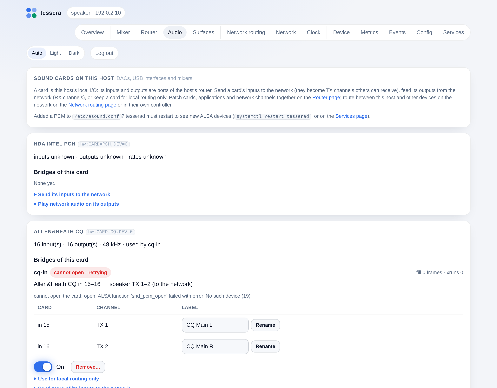
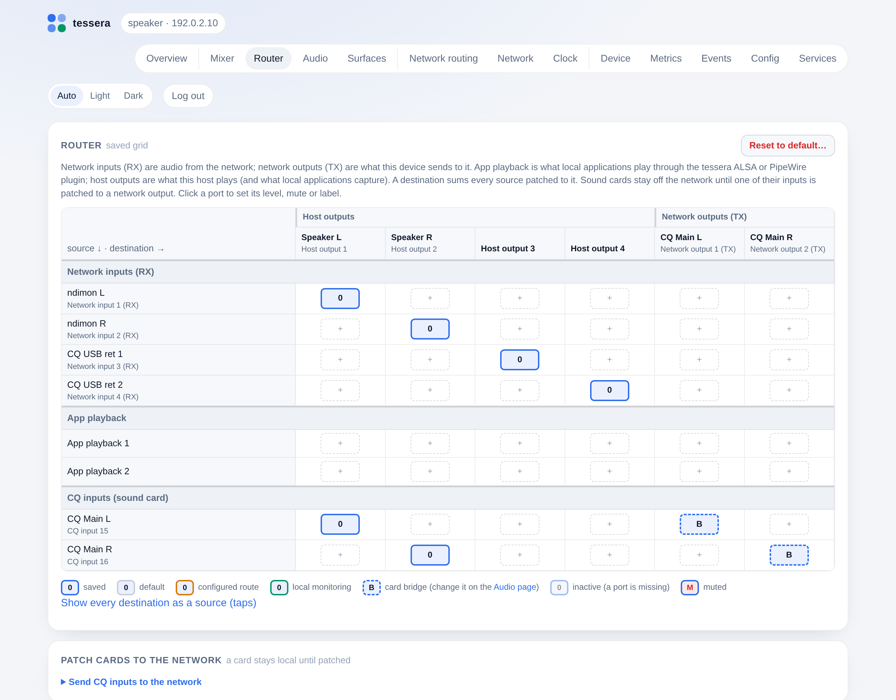
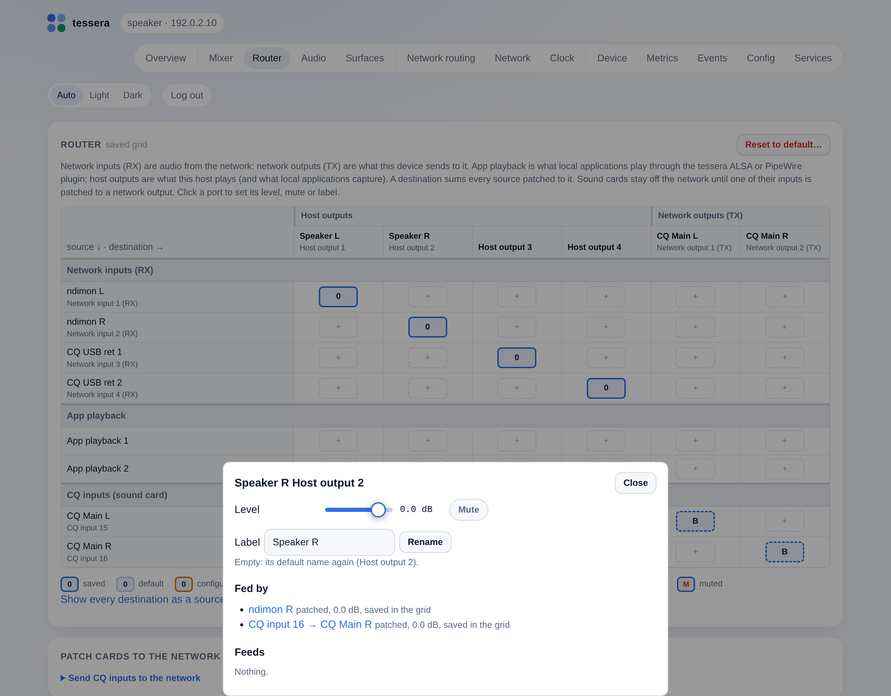
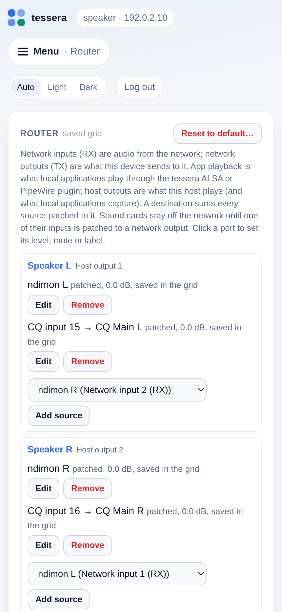
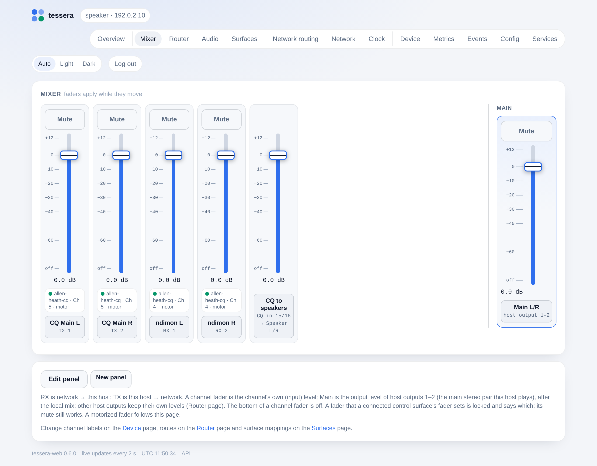
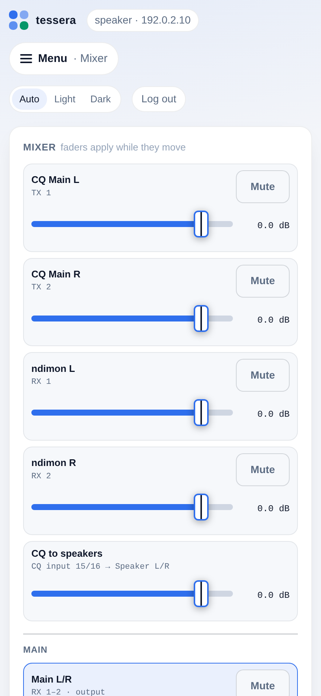
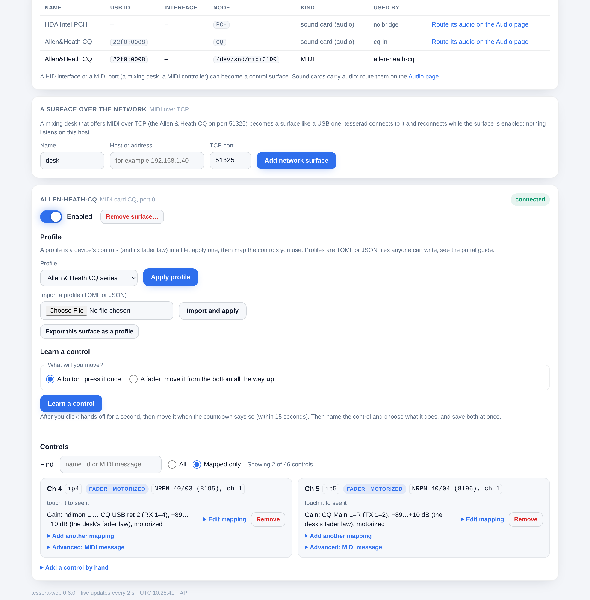
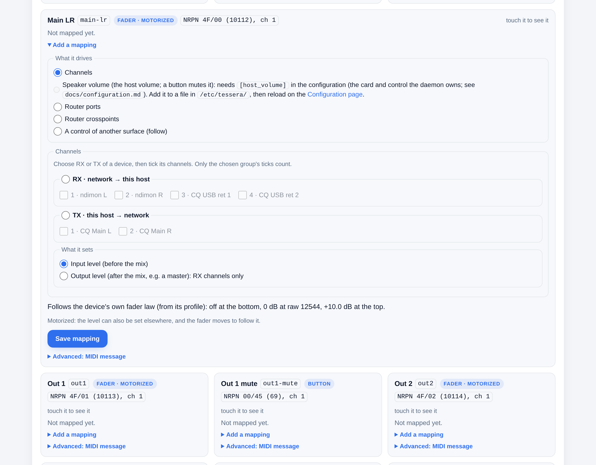

# Web portal (`tessera-web`)

`tessera-web` shows a tessera device in a browser and changes what `tesseractl`
can change. It is a separate service and a client of the daemon's
control socket, like `tesseractl` (it uses the same client library). It never
touches the daemon's state directly. Standalone host networking uses the
separate typed Rust helper described in [network-vlans.md](network-vlans.md);
NDIMon remains the network owner when it hosts Tessera. Code:
`crates/tessera-web`.

The **Network routing** page connects, replaces and disconnects receive inputs: a
matrix of transmit channels and receive inputs, a review step, then one command
through the daemon ([below](#network-routing)). It routes this host's receiver and other
devices' receivers, so either host's portal can route a pair. The Device page
also keeps a plain-HTML picker for saved subscription intent: choose the
receiving input (RX), transmitting device (TX), output channel, then review the
names before saving. Lists use the daemon's paged inventory; expired selections
require choosing again. Ambiguous names cannot be selected. Advanced manual
entry remains available for offline sources. Network browsing (`[discovery]
browse_devices`) is on by default, and the Network routing page needs it;
`browse_devices = false` opts out.

After an Avahi resolver failure, a returning source can remain absent until a
new discovery session if Avahi keeps its cached service pointer without a new
announcement. Discovery stays reconciling in that case. Prefer advanced manual
entry for saved intent when a source is not listed. Toggling `browse_devices`
off and on with configuration reloads starts a new discovery session;
restarting tesserad also does so but interrupts audio.
The built-in discovery backend cannot identify the interface, and an empty
available cache never proves that the LAN has no devices.

What saving a subscription does depends on who serves the device role
([interoperability.md](interoperability.md#native-device-role)). With the
native device role, the saved subscriptions are what the daemon requests from
transmitters: saving, replacing or removing one connects, changes or
disconnects that input, although the picker's own messages still say that
audio flows are unchanged. With the compatibility runtime, saving intent does
not connect or disconnect audio, and the daemon refuses it for the first
device while the runtime is registered; use the Network routing page there.

The **Router** page is the host router: this host's own grid between its
local I/O (sound cards, applications, the speaker) and its network channels
([below](#router)). A sound card reaches the network only when patched there. Existing
configured flows and routes established through Dante Controller continue to
carry audio; intent, carrier ownership and packet observations are shown
separately. Packet activity does not verify the selected source.

---

## Contents

- [Install and start](#install-and-start)
- [Pages](#pages)
- [JSON API](#json-api)
- [Authentication and sessions](#authentication-and-sessions)
- [Configuration (`web.toml`)](#configuration-webtoml)
- [Network exposure](#network-exposure)
- [Rights](#rights)
- [Service unit](#service-unit)
- [Appliance mode](#appliance-mode)
- [Limits](#limits)

---

## Install and start

```sh
sudo apt install ./tessera-web_<version>_<arch>.deb
sudo tessera-web set-password                 # optional: replace the initial tessera password
xdg-open http://127.0.0.1:8090                # or, from another machine, an SSH tunnel:
ssh -L 8090:127.0.0.1:8090 user@device        # then open http://127.0.0.1:8090 there
```

The package creates the user `tessera-web` (a member of groups `tessera` and `tessera-admin`),
installs `/etc/tessera/web.toml` (a conffile with every key commented out) and
the unit, enables and starts the portal on a fresh install, and initializes
the password to **`tessera`** only if no password file exists. Upgrades preserve
an existing password and restart a running portal. Purging
the package deletes `web.toml` and the password file.

If `tessera` is refused after an upgrade, an existing password was preserved.
Use `sudo tessera-web set-password` on the device to choose a replacement of
at least eight characters. The command prompts privately; do not put the
password in command arguments. The new password applies at the next login
without restarting the portal or audio services.

---

## Pages

The **Services** navigation entry (`/services`) is present by default, even
without Speaker mode. It lists the audio daemon, Controller compatibility
(`tessera-controller@main`), portal, network configuration and Avahi discovery.
Status, enable/disable and restart use the existing service allowlist, session,
CSRF and essential-service confirmation checks. A configured
`[[appliance.service]]` list replaces these defaults, including on the Services
page. Package installation generates the matching polkit rules automatically;
regenerate them with `tessera-web appliance polkit` after editing the list.

Server-rendered HTML with forms. Status pages use a small same-origin browser
script (`/live.js`) to read fresh HTML in the background and update values in
place, without reloading the document. Focused or edited forms, file
selections, expanded details and scroll position are preserved. Hidden tabs
pause polling; failed reads retain the last values and retry with backoff.
The same script posts the Speaker page's sliders and service buttons, the
Device page's channel gain sliders and mute toggles, and a surface's enabled
switch in place: the same forms and token, with the header `X-Tessera-Live: 1`, which
makes the handler answer JSON (`{"ok": …, "text": …}` and a few fields of
its own) instead of a redirect and a one-shot message; every other check
(session, token, origin, allowlists, confirmations) is the same. Without
JavaScript, pages and forms still work (the sliders keep an **Apply**
button); status changes need a manual reload. Every page except the login
page needs a session.

Every page of a session has the same frame: a top bar with the brand, a host
chip (the device's name and the primary interface's address, once a status
was seen), the navigation (the current page marked, `aria-current="page"`),
the theme control and **Log out**; a footer with the portal's version, the
page's refresh interval and the UTC time. The navigation is one row in
groups: the overview (and **Speaker** in appliance mode), then **Audio**
(Mixer, Router, Audio, Surfaces), **Network** (Network routing, Network,
Clock) and **System** (Device, Metrics, Events, Config, Services). Under
720 px it is a **Menu** button instead (a `<details>` disclosure, no script
needed) that says the current page and opens the same links in the same
groups. The URLs are the same either way. Without a session (the login page,
a missing page) only the brand is shown. Content is in cards on a
twelve-column grid that stacks on a phone (under 720 px).

| Path | Page | Refreshes | Changes |
|------|------|-----------|---------|
| `/` | Overview: the **signal path** (network, flows, device, audio clients; a path is highlighted while packets move on it, judged from two metric samples), devices, network, clock, warnings | every 5 s | |
| `/mixer` | Mixer: the saved mixer panels (a tab each), or the default desk of channel strips (input level and mute per channel in use, Main L/R) ([below](#mixer)); `/mixer/edit`: the panel editor | every 2 s | fader levels (live while dragged), mute, Main (the daemon's host volume, the portal's amp volume or the output stage); create, edit and delete panels and strips, link strips to surface controls |
| `/network` | standalone VLAN profiles (addressing, and management's DNS servers and search domains) and management/audio assignments; legacy interface selection where the helper is absent | | edit a draft, review/apply, explicitly keep or revert |
| `/devices` | Device: per device, the access lock, settings, per-channel input level, RX output level and mute ([below](#channel-gain-and-mute)), channel labels, the receiver's routes, subscriptions | every 5 s | lock and unlock (see below); name, rate, encoding, latency; channel counts (with a confirmation step, see below); mute and gain per channel; labels; subscribe and unsubscribe (what that does: above the table) |
| `/surfaces` | Surfaces: the devices the host has (USB HID interfaces, MIDI ports, sound cards) and the configured control surfaces with their live control values and mappings ([below](#control-surfaces)) | every 2 s | add a HID device or MIDI port, or a desk over the network (MIDI over TCP), as a surface, apply, import or export a profile, enable or disable, remove (asks first), learn a control and map it in one form, edit its layout, map it to channel mute or gain, the speaker volume, router ports or crosspoints, or a control of another surface (follow) |
| `/audio` | Audio: the host's sound cards (DACs, USB interfaces, mixers), each with its bridges and their channels, and local monitoring per device ([below](#audio)) | every 2 s | send a card's inputs to TX channels or play RX channels on its outputs (growing the device when needed, after a confirmation), or open a card for local routing only; name the channels, switch, convert or remove a bridge, choose local monitoring |
| `/router` | Router: the host router's grid of sources (network RX, apps, card inputs) and destinations (host output, network TX, card outputs) ([below](#router)); `/router/crosspoint`, `/router/port` editors | every 2 s | patch and remove crosspoints, crosspoint gain and mute, port level, mute and label, patch card inputs to the network, reset to the default grid |
| `/routing` | Network routing: the matrix of transmit channels and receive inputs, or a list ([below](#network-routing)); `/routing/review`, `/routing/recovery`, `/routing/carrier-recovery` | every 10 s | Connect, Replace, Disconnect after a review; this host's own crosspoints set local monitoring; recovery of an uncertain operation |
| `/clock` | clock settings and the clock table | every 10 s | role and priority |
| `/metrics` | daemon counters (with the audio clients), media engine counters, per-flow counters | every 5 s | |
| `/events` | the latest events since the portal started (it keeps 200), newest first, UTC | every 5 s | |
| `/config` | the configuration in effect (TOML) | | reload the configuration |
| `/login`, `/logout` | log in (a centred card) and out | | |
| `/theme` (POST only) | | | choose the appearance, see below |
| `/speaker` | **appliance mode only** ([below](#appliance-mode)): the control panel: volume and signal boost, warnings, host vitals and the daemon summary, the clock, one switch per configured service, sources, the signal path, devices and subscriptions, EQ files, network, links | every 5 s | volume and boost (live sliders), enable, disable or restart an allowlisted service (an essential one asks first), EQ files |
| `/device`, `/overview` | appliance mode only: the overview (`/` redirects to `/speaker`) | every 5 s | |
| `/assets/<hash>/style.css` | the stylesheet, at a path that changes with its content (cached for a year); `/style.css` and `/static/style.css` serve it uncached | | |

### Audio

`/audio` (provisional 0.x) refreshes every 2 s. It is where you attach the
host's sound cards (DACs, USB audio interfaces, mixing desks such as a FIFINE
SC3 or an Allen & Heath CQ) as in-daemon ALSA bridges, either feeding network
channels directly or opened for the host router only.

* One section per **sound card** the daemon detects: its name and ALSA PCM
  (`hw:CARD=SC3,DEV=0`), inputs and outputs, supported sample rates, and what
  uses it. A card's sample rate must match the Tessera device's rate (the
  bridge compensates clock drift, not nominal sample-rate differences). When a
  device's rate is not among the card's, the card warns: **This card can't run
  at 96 kHz; set the device to 48 kHz on the Device page.**
* **Bridges of this card**: each bridge with its mapping in words (**SC3 in
  1–2 → speaker TX 1–2 (to the network)**, **CQ in 15–16 → speaker TX 1–2 (to the
  network)**, **speaker RX 3–4 → USB DAC out 1–2 (from the network)**), its
  state (**running**, **opening**, **cannot open · retrying** when the card
  could not be opened (missing, busy) and the daemon tries again, **error**,
  **disabled**, with the daemon's last error), fill and xruns, an on/off switch, **Remove…** (asks first) and
  the device channels it carries with their labels, each renamed in place
  (`SetChannelLabel`; an empty label restores the default). A card can have any
  number of bridges.
* **Send its inputs to the network** / **Play network audio on its outputs**
  (**…more…** once it has one): device, first TX (or RX) channel, **First card
  input / output** (`card_first_channel`, 1-based — for example `15` for an
  Allen & Heath CQ's Main L/R mix on USB channels 15–16), number of channels
  (at most the card's), bridge name, one label per channel prefilled from the
  card (**SC3 L**/**SC3 R** for a stereo card, else **CQ12T In 1**, **CQ12T Out
  1**, …) and **Low latency** (96-frame card periods, 2 ms at 48 kHz; default
  10 ms). The first device channel defaults to the next free one: not carried
  by another bridge and, for RX, not subscribed; a range that overlaps one is
  refused with the channel to start at. When the range goes past the device's
  last channel the form says how many it adds; saving then sends
  `SetDeviceChannels` first, which restarts the device, so the usual **Confirm
  the change** page comes first, then `SetCardBridge` and a `SetChannelLabel`
  per named channel (`POST /audio/bridges`).
* **For local routing only** (a check box of the same form, and **Use for
  local routing only** on an existing bridge): the card is opened for the
  host router only (`CardBridgeSpec::local_only`): its channels become router
  ports (`card_in` / `card_out`), no device channel is fed or read, and the
  card stays off the network until a crosspoint patches it there
  ([Router](#router)). The bridge then shows **local routing only** instead of
  its device channels. Converting a network bridge (`POST
  /audio/bridges/{name}/local`, `local=true`) sends `SetCardBridge` with
  `local_only`, and with **Keep the same path** (on by default) `SetCrosspoint`
  card in → the same TX channels (removing the default app → TX crosspoint of
  each) or host out → card out, so nothing changes on the network. **Put it on
  the network again** removes those crosspoints and feeds the device channels
  again. The on/off switch keeps `local_only` and `card_first_channel` as they
  are. A tesserad without the host router refuses `local_only` (`Unsupported`),
  and the page says so.
* Bridges whose card is not detected (unplugged, or a PCM the daemon does not
  list) are listed apart. Bridges of the configuration files (`[[bridge]]`)
  are shown the same way, but the daemon refuses to switch or remove them
  (**This bridge is set in the configuration files: change it there.**).
  Switching a bridge off and on again uses the daemon's default card period.
* **Local monitoring** per device: a grid with one row per RX channel (what
  the device plays) and a radio per TX channel (a local input), or **none**,
  plus the delay in ms (`0` = auto, the lowest safe delay, and the default).
  It plays a local TX channel on this device's own RX outputs too, after that
  TX channel's gain and mute (`SetMonitor`, `POST /audio/monitor/{device}`).
  The [Router](#router) supersedes local monitoring for anything beyond a
  one-to-one TX → host-output tap (for example, mixing a `local_only` card
  input straight into the speakers with per-crosspoint gain, without using a TX
  channel). While no router grid is saved, local monitoring appears in the
  router as `monitor` taps; once a grid is saved, `SetMonitor` updates that
  device's TX-tap → host-output crosspoints in the grid. A channel is named
  once: its label, with `RX 2` beside it only when the label is something
  else. The delay field is empty with **auto** shown while the delay is 0;
  an empty field saves auto; a fixed delay says so and that auto is
  recommended. **Once the router's grid is saved** the monitoring card is
  read-only: the grid's taps of TX channels into host outputs are what plays,
  so the card lists them and links to the Router page, the one place to change
  them (the Network routing page's local-mix cells follow the same rule).
* The bridge sentences name the device by its name, not its key
  (`SC3 in 1–2 → speaker TX 1–2 (to the network)`).



*The Audio page with an Allen & Heath CQ capture bridge (`cq-in`), channel
labels, and local monitoring. The `cannot open the card` notice in this capture
is from a test VM without the physical USB mixer attached; on a host with the
card connected the badge shows **running**.*

A PCM added to `/etc/asound.conf` appears only after `tesserad` restarts: the
page says so. Card detection is the daemon's; the page never opens a card. The
packaged `tesserad.service` runs with `SupplementaryGroups=audio` so the daemon
can open `/dev/snd/*` cards and MIDI ports without an extra unit drop-in.

### Router

`/router` (the **Router** entry in the Audio group; provisional
0.x) is the host router: one saved grid between this host's **local I/O** and
its **network channels**. Tessera is an audio routing device; network routing
interoperable with Dante® is one of its capabilities. Two layers keep them
separate:

* **Network channels** are the host's logical network device (one by default,
  `main`). Its RX (network → this host) and TX (this host → network) channels
  are what network controllers see, and nothing else.
* **Local I/O** — sound-card inputs and outputs (opened by card bridges), what
  local applications play and capture, and the speaker output — stays local
  until a crosspoint patches it to or from a network channel.

Every crosspoint mixes one source port into one destination port with its own
gain and mute, and a destination sums every crosspoint that feeds it. For
example, a speaker's left output can sum network RX 1 (`ndimon L`) and a mixer's
USB input 15 (**CQ input 15**) locally, with no network hop. The page refreshes
every 2 s.



*The Router grid on a speaker with an Allen & Heath CQ: CQ inputs 15 and 16
are patched into `Speaker L` and `Speaker R` alongside `ndimon L/R`, while
the dashed **B** cells show the network card bridge feeding `CQ Main L/R` on
the network outputs.*

* **Names.** Ports are named in plain words, never by their internal kind
  or device key: **Network input 2 (RX)**, **Network output 1 (TX)**, **App
  playback 1**, **Host output 2**, **CQ input 15**, **CQ output 3** (the
  device's name is added only when the host has several devices). A port
  someone named (a channel label, a router port label: the report's
  `custom_label`) shows that name, with where it is under it. A card input
  that feeds a named network output shows that name too: in the grid that
  name on top and the card input under it (**CQ Main L** over **CQ input
  15**, like a named port, so it does not read like a route inside the grid;
  its accessible name is "CQ Main L from CQ input 15"), in lists **CQ input
  15 → CQ Main L**, so the Router, the Audio page and the Mixer use the same
  name for one input.
* **The grid.** Sources are rows, grouped: **Network inputs (RX)**, **App
  playback** (what local applications play into the device through the
  tessera ALSA or PipeWire plugin; the group says so), **<card> inputs
  (sound card)** per card, then **Taps** (a destination used as a source:
  what it carries after its own level). Destinations are columns: **Host
  outputs** (what this host plays: local applications capture it; on a
  speaker its DSP and amplifier play it), **Network outputs (TX)**, **<card>
  outputs (sound card)**. With up to ten destinations the grid takes the
  card's width and their headers are horizontal and wrap (more are rotated
  to keep it narrow); the headers stay in view while the grid scrolls. It is
  a real table (`scope="col"`, `scope="row"`, column and row groups); the
  arrow keys move between crosspoints, Home and End to the ends of a row.
  Only the taps in use are rows; **Show every destination as a source
  (taps)** (`/router?taps=1`) shows them all. Loops through taps are refused
  by the daemon.
* **In place.** With the page's script a patch, a removal and **Add source**
  post in place (the same form and token, answered in JSON); the answer is
  shown above the grid and the focus returns to the cell after the grid is
  read again. A patched cell, a port header and a phone row's **Edit** open
  the editor in a dialog on the page (the same server-rendered editor, whose
  forms post in place; **Remove crosspoint** closes it). The dialog's title is
  the editor's heading: a named port reads as its name and its place apart
  (`Speaker R — Host output 2`), on the editor page too. The dialog has its
  own **Close**: the editor page's **Back to the router** link is left out
  there (it stays on the editor page itself, and without the script). Without the script
  every form posts and every link opens the editor page, as before.
* **A crosspoint.** An empty cell is a **+** button: one click patches the
  source into the destination at unity (`SetCrosspoint`,
  `POST /router/crosspoint` with `source`, `destination`, `on=true`). A
  patched cell shows its gain (`0`, `−6`, `M` when muted) and opens its
  editor (`/router/crosspoint?x=…`): a gain slider (`SetCrosspointGain`,
  `POST /levels/crosspoint/gain`), **Mute** (`SetCrosspointMute`,
  `POST /levels/crosspoint/mute`) and **Remove crosspoint**
  (`RemoveCrosspoint`). Its border tells where it comes from: **saved** (the
  saved grid), **default** (the default grid while none is saved),
  **configured** (a `[[route]]`), **monitor** (local monitoring); a
  dashed **B** is implied by a card bridge that feeds the network (without
  `local_only`): read-only, it links to the bridge on the Audio page. A faded
  cell is inactive (a port is missing; its tooltip says why) and is kept until
  its port is back. A gain a non-motorized surface fader owns is locked:
  **Locked: set by the <surface> fader**; mute still works.
* **A port.** A row or column header opens the port's editor
  (`/router/port?p=…`): its level and mute (`SetPortGain`, `SetPortMute`,
  `POST /levels/port/gain|mute`; on network ports and host outputs these are
  the same stored values as the channel and output-stage controls of the Device
  page), its label (network channels with `SetChannelLabel`; local ports and
  host outputs with `SetPortLabel`, which touches nothing else; an empty label
  gives the port its default name again), what feeds it and what it feeds. The
  message says where the port is in plain words (**Host output 2 is now
  “Speaker R”.**).



* **Nothing saved.** Until a grid is saved, the **default grid** applies, which
  matches Tessera 0.5 behaviour: each RX channel feeds the host output of the
  same number, each app output feeds its TX channel (unless a capture bridge
  feeds it), plus local monitoring and any configured `[[route]]` entries. The
  first edit saves the default grid first and then applies your change, so you
  never lose the routes in effect. **Reset to default…** asks first, then sends
  `ResetRouter`.
* **Patch cards to the network.** A `local_only` card stays off the network
  until one of its inputs is patched to a TX channel. Per card, **Send <id>
  inputs to the network** lists the inputs not on the network yet, each with
  the label its new channel gets: `POST /router/patch` sends
  `SetDeviceChannels` (one more TX channel per input; the device restarts, so
  **Confirm the change** comes first), `SetChannelLabel`, then per input
  `SetCrosspoint` card in → the new TX channel and `RemoveCrosspoint` of the
  default app → TX crosspoint of that channel (absent is fine). Other devices
  then see them as TX channels of this host's device. **Feed <id> outputs from
  the network** does the same with new RX channels and `SetCrosspoint` network
  RX → card out.
* **On a phone** (under 700 px) the grid becomes a list of destination cards:
  each card lists the sources that feed it, each with visible **Edit** and
  **Remove** buttons (a bridge's: **Change on the Audio page**), and an **Add
  source** picker.



* **A daemon that cannot apply the router.** When the report says
  `read_only` the grid is shown without any edit control and a notice says
  so; levels, monitoring and bridges still change on their own pages. A
  command the running tesserad cannot apply is refused by the daemon
  (`Unsupported`), and the page shows **Not supported yet by this tesserad:
  … Nothing was changed.** A daemon that predates the router (no
  `Query::Router`) gets a notice instead of the page.

### Network routing

`/routing` shows a matrix: transmit channels (TX, this host → network) down
the left, grouped by device, and receive inputs (RX, network → this host)
across the top, grouped by device. Device bands can be collapsed (a collapsed
band shows read-only route counts, including static configuration flows), both
axes can be filtered, and **List** shows the same routes receiver by receiver
(the view on a narrow screen). The first four devices' inputs are read when the
page loads; further devices have a **Read inputs** link. When this host's own
receiver does not answer (its routing runtime is not running, for example on a
host that does not take the native role), its inputs are still listed, from the
daemon's status (`Status` RX channels and their labels): read-only, their
selections shown as not read, with the plain reason **this host's routing
runtime isn't running or didn't answer**; local mix cells still work. Transmit channels come
in pages of 16. A column's title names the device, marks this host, gives its
16-digit device ID (the value for `[control] routing_sources`,
[configuration.md](configuration.md#receiver-routing)) and explains in plain
words when its inputs cannot be changed. Each cell shows the state of the
route: receiving, receiver-confirmed, no media, pending, empty or unavailable.

* **Static `[[flow]]` entries** are shown directly in the matrix: a crosspoint
  fed by a configuration flow shows as receiving (or waiting / no media),
  read-only, with **from the configuration (config flow `<id>`)**. An input fed
  by a configuration flow whose sender does not match a listed transmitter
  shows **receiving from `<peer>` (config flow)** in its column header.
* **Every local RX input** of this host is listed with its configured channel
  labels, even if the runtime reports a shorter page.
* **Bridge annotations** come only from **enabled** bridges (preferring a
  running bridge), so a disabled bridge no longer labels a channel another
  bridge feeds: a TX row fed by an enabled capture bridge and an RX column
  played by an enabled playback bridge name it (**In 1 · CQ12T in 1**, **Out 3
  → CQ12T out 1**). The card channel counts from the bridge's first card
  channel (a bridge on CQ USB channels 15–16 names TX 1 **CQ in 15**); a
  bridge kept for local routing only carries no network channel and names
  none.

A cell opens a change: **Connect** an empty input, **Replace** its source, or
**Disconnect** the current one. The review page shows the change and the current
source; **Confirm change** sends one command, and the result page says whether
the receiver confirmed the selection, refused it, had changed in the meantime,
or whether the outcome is unknown (then further changes on that receiver wait
for **Recover uncertain operation**,
[troubleshooting](troubleshooting.md#recovering-an-uncertain-routing-operation)).
Nothing is retried. The daemon checks the receiver's selection, the source and
the locks again before it sends anything. Allow about five seconds for audio to
settle.

A cell is disabled when the receiver cannot be changed — the column title gives
a plain reason alongside the reason code (for example, `operation_unavailable`
explains **the compatibility runtime isn't registered; local mix cells still
work**; other reasons include a `subscriptions` lock, the device access lock,
an uncertain operation, or a remote receiver with more than one page of
inputs), when the source's name is ambiguous, or, on a receiver still on the
compatibility runtime, when the source channel already feeds another input of
that receiver. A receiver on another device is changed over that device's
control protocol and applies its own locks. A confirmed selection does not
verify audio: "receiving" means packets arrive. **Review restart recovery** is
for hosts on the compatibility runtime
([troubleshooting](troubleshooting.md#reviewing-carriers-after-a-runtime-restart)).

A device never receives its own transmission over the network, so this host's
own TX × RX crosspoints are **local mix** cells instead (dashed; marked when
on, with a legend entry): they remain clickable even when network routing is
unavailable (`operation_unavailable`). Clicking one opens the same review
dialog, and **Confirm change** sends one `SetMonitor` that makes that RX
channel also play that TX channel (or nothing, from an active cell), keeping
the other channels and the delay (`GET /routing/local-review`, `POST
/routing/local`). Once a router grid is saved, local monitoring is
part of the grid: each local-mix cell shows that grid's tap (the TX channel
into the RX channel's host output), read-only, as a link to that crosspoint on
the [Router](#router) page, and the legend says so. The review, `POST
/routing/local` and the Audio page's **Save monitoring** then refuse with
**The router's grid is saved: local monitoring is part of it. Change it on
the Router page.** **Sound cards and local routing** opens the [Audio
page](#audio).

Above the matrix the page says how complete the device list is: **Device
browsing is off on this host** when `[discovery] browse_devices = false` (no
refresh changes that: set it to `true` in `/etc/tessera/config.d/` and
reload), that browsing is starting or failed, or **Discovery is incomplete**
with each device that cannot be routed yet and why (for example **STAGEBOX-01:
its controller runtime is not running**). Nothing is shown when the list is
complete.

### Device access lock

Each device card on `/devices` starts with **Access lock: open** or **locked**,
and the overview's device table has an **Access** column. An open device offers
**Lock**: the PIN (four digits) typed twice; the portal refuses a mismatch or
another form before asking the daemon. A locked device says what is refused
and offers **Unlock** with the PIN. The commands are the same `LockAccess` and
`UnlockAccess` that `tesseractl access` sends, and the daemon decides
everything ([what a lock refuses](cli.md#access), [where it is stored and how
the PIN is protected](configuration.md#device-access-lock)). The PIN fields are
password fields that the browser is asked not to fill in; the portal never
logs, shows or keeps a PIN. Wrong PINs from the portal are counted apart from
the command line: after five, unlocking from the portal pauses for 60 s while
`tesseractl access unlock` still works.

There is no reset in the portal: a forgotten PIN is reset by an administrator
on the device (`sudo tesseractl access reset`). The daemon refuses a reset sent
by the portal's account, and `POST /api/v1/commands` refuses
`reset_access_lock` itself (403) without forwarding it.

### Channel gain and mute

Each device card on `/devices` has **Levels and mute**: per direction (RX,
network → this host; TX, this host → network) one row per channel with a
**Mute** toggle (pressed while muted) and an **Input level** slider from off
(the bottom) to +12 dB in 0.5 dB steps, with its value beside it. An RX row
also has **Output (after the mix)**: **Mute output** and an output level
slider. The input level is the channel's own (for RX, the network source
before the local mix); the output level is what the device plays after the
local mix, network audio and monitored inputs together, like a master fader.
They send `SetOutputMute` and `SetOutputGain` (the same URLs with
`stage=output`, like `tesseractl output-mute` and `output-gain`). An
`OutputGain` surface binding does not take over the output level; however, a
connected non-motorized fader bound to `PortGain` on that channel's `HostOut`
router port does own it (`ChannelStatus::output_gain_owner`), in which case
`SetOutputGain` from other origins is refused (`LevelOwned`) and the slider is
locked. With the page's script the
toggle applies in place and the slider applies when released (keyboard steps
are gathered for a moment first); without it the toggle posts and returns to
the row, and the slider has a **Set** button. They send `SetChannelMute` and
`SetChannelGain` for that one channel (`POST /devices/{key}/mute`,
`POST /devices/{key}/gain/{rx|tx}/{channel}`), like `tesseractl mute` and
`gain`. Exact values below −80 dB come from the command line or the API; the
readout shows them. The RX and TX tables sit side by side only when both fit
(about 680 px each) and are stacked otherwise; under 720 px each channel is a
card (its name and **Mute** on top, each level a labelled full-width slider),
so no column scrolls out of view on a phone.

While a connected control surface's non-motorized fader sets a channel's gain,
its slider is locked: a hatched grey track and hollow thumb in a dashed frame,
with **Locked: set by the <surface> fader** beneath it (a link to that surface
on `/surfaces`, and the slider's accessible description); its Mute toggle
still works. Should the gain be sent anyway (another tab, the API), the daemon
refuses it and the page says **The gain of main RX 1 is set by the sc3 fader;
mute still works.** With the script the slider is then handed back to the
refresh, which shows the daemon's value and the lock at once. Row anchors
carry the device key (`/devices#level-main-rx-1`). The **Speaker** page's
volume card is separate and unchanged.

### Mixer

`/mixer` (the **Mixer** entry, after the overview; the Speaker page's master
card has **Open mixer**) shows the device's channels as a mixing desk: one
strip per channel with a tall vertical fader for its own (input) level, its
dB readout and scale (top +12 dB, bottom off), a **Mute** button, the
channel's label at the bottom like a scribble strip, and the surface controls
mapped to the same channels (a badge per control, linking to it on
`/surfaces`: the control's label, `· motor` for a motorized fader, and the
surface's name in front only when more than one surface is enabled; the
badge's title and accessible name always say the surface). Strips are grouped: the channels **in use** first, TX before
RX (a TX channel is in use when a capture bridge that is not disabled feeds
it; an RX channel when it has a subscription, a saved routing intent or a
carrier), the others folded under **More channels** (a device with nothing
in use shows every channel), then **Main L/R**, drawn apart.

Main is the speaker volume tesserad sets when its status reports one
(`Status::host_volume`, from `[host_volume]` in the daemon's configuration):
the fader sends `SetHostVolume` (`POST /host/volume`, the configured range,
0.5 dB steps) and **Mute** `SetHostMute` (`POST /host/mute`); a
non-motorized surface fader that owns the volume makes it read-only with a
link to that fader. While the daemon has no host volume, Main is the
amplifier's volume set by the portal when `[appliance.volume]` is configured
(its range, the same `POST /speaker/volume` as the Volume card, and **Unmute
the amplifier** while the card's playback switch is off); otherwise it is the
output stage of the main stereo pair, host outputs 1–2 (RX 1–2 after the
local mix; on the speaker, what the amplifier plays): one `SetOutputGain`
and one `SetOutputMute` for both. Other host outputs (a desk's USB returns
on outputs 3–4) keep their own levels. The scribble strip says exactly what
Main is: **host output 1–2**, **speaker volume** or **amplifier volume**,
with the full sentence in its tooltip and accessible description.

On every strip the scribble strip's second line is a few words (a strip on
two crosspoints reads `CQ (2) → Speaker L/R`, on two unnamed card inputs
`CQ in 15/16 → Speaker L/R`: unnamed ports say `in` and `out` for `input` and
`output` there, and the line wraps to at most three lines); the full list is
its tooltip and accessible description. A strip without buttons keeps their place, so
its fader lines up with its neighbours'. A saved strip without a label shows
its channels' labels (on the panel and in the editor's list), never the
device key and channel.

Every control posts to the existing handlers, so each change is the same
command as on the Device page: `POST /devices/{key}/gain/{rx|tx}/{channels}`
(`SetChannelGain`, or `SetOutputGain` with `stage=output`) and
`POST /devices/{key}/mute` (`SetChannelMute`/`SetOutputMute`). `channels`
(and the mute form's `channel`) is one channel or a comma-separated list
(`1,2,3,4`), each once. With the page's script a fader applies while it moves
(one request at a time, the newest value next, at most every 150 ms) and
once more on release; the refresh never moves a fader that is being dragged
or focused. Without it each fader has a **Set** button and each form returns
to its strip (`back=/mixer#<strip>`; the handlers accept no other return
address). A fader whose gain a connected non-motorized surface fader owns is
locked like on the Device page (**Set by the <surface> fader**); its mute
still works; a motorized fader owns nothing, and the strip follows it on each
refresh. On a phone (under 640 px) each strip is a row with a horizontal
fader; on wider screens the strips sit side by side and scroll inside their
card.



*A custom Mixer panel on desktop: channel faders for `CQ Main L/R` (TX 1–2) and
`ndimon L/R` (RX 1–2), a crosspoint fader (`CQ to speakers`) controlling the
level of CQ inputs 15–16 mixed into Speaker L/R, and `Main L/R` drawn apart.*



**Saved panels.** The panels come from the daemon (`Query::Mixers`, one
`MixerSpec` each, in id order); while none is saved the page shows the
default desk above, and an older daemon that does not know panels gets the
same. Several panels are tabs (`/mixer?panel=<id>`). A saved strip is one
control: a fader (input level, output level, the speaker volume, a router
port's level, a crosspoint's gain) or a button (the mutes of the same
targets, toggle, hold to mute or push to talk); a button right after a
fader on the same target, with no label or group of its own, is drawn under
that fader as one channel strip. An empty label shows the target's labels.
Port and crosspoint strips post to `/levels/port/*` and
`/levels/crosspoint/*` ([Router](#router)). A strip whose target is gone (a
channel or port that no longer exists, a crosspoint not patched) is kept as
saved and says **Not available: …**. While the portal sets the amplifier's
volume itself, its Main stays on every panel. Linked surface controls show as
badges, derived from the surfaces' mappings (`StripControl::links_to`), never
stored in the panel.

**The editor** (`/mixer/edit`, **Edit panel** on the page): with nothing saved
it offers **Save the default panel and edit it** (`SetMixer` id `main`: the
strips in use and Main) or **Start an empty panel**; **New panel** asks for a
title (the id is made from it). Per panel: **Rename**, **Delete panel…**
(asks first; `RemoveMixer`), and per strip **Up**/**Down**, **Delete…** (asks
first), label, group heading, master and button mode. **Add a strip** chooses
the action, then its target: channels of one device and direction by label,
router ports or patched crosspoints by label (from `Query::Router`), or
nothing for the speaker volume (offered only when the daemon owns it); a
fader may get its own travel. With the script only the picker the action
needs is shown. **Link a surface control** picks a free control of the right
kind (faders and encoders for a fader strip, buttons for a button strip) or
**Learn**s one (the learn flow of the Surfaces page; the learned control is
named and added to the surface); linking sends `SetSurface` with the binding
(the strip's action and target, its travel or the host volume's range, its
button mode) and then `SetMixer`, so a failure of the second leaves a working
binding. **Unlink** removes that binding (`SetSurface`). A non-motorized
surface fader then owns the level (read-only here); a motorized one follows;
mute is never owned. Every change is one `SetMixer` with the whole panel; a
refusal (`InvalidMixer`) is shown with the daemon's reason.

### Control surfaces

`/surfaces` (provisional 0.x) refreshes every 2 s. Tessera connects out to
hardware surfaces — local USB HID interfaces (`/dev/hidraw*`), ALSA rawmidi
ports (`/dev/snd/midi*`), and desks that speak raw MIDI over TCP. It does not
expose a MIDI port or listener of its own for other software to control it in
0.6 (roadmap item).



From top to bottom:

* **Devices on this host**: name, USB ID, interface, node, kind and what uses
  it. On a phone (under 720 px) each device is a card of labelled lines. A HID
  interface or MIDI port no surface uses has **Add as surface**, with a name prefilled from
  the product name (`fifine SC3` → `fifine-sc3`; letters, digits, `-` and
  `_`). It sends `SetSurface` with the device's source, enabled, without
  controls. Sound cards are listed too, as **sound card (audio)**, with **Route
  its audio on the Audio page** ([Audio](#audio)).
* **A surface over the network**: a desk that offers MIDI over TCP (the Allen
  & Heath CQ on port 51325) is added with a name, its host or address and
  the port (`POST /surfaces/add-tcp`, `SetSurface` with the `tcp_midi`
  source). tesserad connects to it and reconnects with back-off while the
  surface is enabled; Tessera connects out only and never listens. Its controls
  are addressed like a MIDI port's (profiles, learning, the MIDI message
  fields); its card shows **MIDI over the network, <host> port <port>**.
* **Profile** (HID and MIDI surfaces): **Apply profile** offers the profiles
  that fit the device first (by MIDI card name or USB id), then the others of
  the same kind; it adds the profile's controls (replacing those with the same
  id, keeping the surface's others and every mapping) and gives mapped faders
  the profile's fader law, in one `SetSurface`. A surface with no controls
  whose device a profile fits says **This looks like Allen & Heath CQ series:
  apply its profile to add its 46 controls at once.** **Import a profile**
  uploads a TOML or JSON file (checked strictly — unknown keys anywhere are
  refused with the reason) and applies it the same way (the session and the
  form token, the first field of the upload, are checked before the file is
  read; the file is read up to the profile limit, 256 KiB, and the request
  body is capped just above it); **Export this surface as a profile**
  downloads it as TOML. The format:
  [surface-profiles.md](surface-profiles.md). The list is the daemon's profiles
  (built in, `/usr/share/tessera/surfaces/`, and `/etc/tessera/surfaces.d/`)
  plus the one imported for that surface.
* **Many controls** (more than eight, such as a desk after its profile):
  above them a filter with **Find** (name, ID or MIDI message) and **All /
  Mapped only**, with a count of those shown. With the script it filters in
  place (a control whose form is open stays); without it the form is a GET
  (`/surfaces?surface=<name>&q=…&show=mapped`) the server applies. An open
  **Add a mapping** or **Edit mapping** form takes the whole row of the
  grid, so the other cards keep their size.
* One card per configured surface: its source, its state (**connected**,
  **not found**, **problem** with the daemon's text, such as a permission
  problem, or **disabled**), an **Enabled** switch (applies in place) and
  **Remove surface…** (asks on a page of its own first).
* **Learn a control** (above the controls): choose what you will move (**A
  button**: press it once; **A fader**: move it from the bottom all the way
  up, which tells an inverted fader), then **Learn a control**. Keep your
  hands off it for a second (the daemon reads the device at rest first), then
  move it: with the script the form says **Hands off for a second…**, then
  **Now move the fader from the bottom all the way up… 13 s** and counts down.
  The request waits up to 15 s (`LearnControl` with `moving_up` for a fader,
  administrators only). The answer is one form: a **Label** (the control's ID
  is made from it, `Mic mute` → `mic-mute`, unique on the surface; `fader-1`
  without a label), **What it does** (the mapping fields below), the option
  that fits the kind (**Inverted** for a fader, **Active low** for a button)
  and, folded under **Advanced: report layout**, the ID, kind, report ID, bit
  offset, bits and max the daemon suggested. On a MIDI surface the result
  shows the message (for example **NRPN 40/02 (8194), ch 1**) and
  **Advanced: MIDI message** holds the kind (CC, NRPN, Note), MIDI channel,
  number and max instead of HID fields; a message that is already a control
  is pointed out. **Save control and mapping**
  sends one `SetSurface` with both; with no channels chosen it saves the
  control alone and says it is not mapped yet. If anything is refused the
  same form comes back as it was typed. If nothing moved, the surface's card
  says so.
* **Controls**: a tile per control with its live value: for a fader a meter,
  the gain its first mapping sets at that position (range and taper as
  mapped; the share of its travel when unmapped) and the raw value; for a
  button a lamp and **pressed**/**up**; values are unknown (**touch it to see
  it**) until the device has reported them (a motorized fader Tessera moved
  shows where it sent it); a MIDI control shows its message.
  Then its mappings in words, the channels by their labels with their numbers
  beside them (the device's name in front only when the host has several), for
  example **Mute: CQ Main L–R (TX 1–2), toggle**, **Gain: ndimon L–R (RX 1–2),
  −60…0 dB, owns gain** or **Output: RX 1–2, −60…+10 dB** for
  channels with their default labels (**motorized** for a motorized fader,
  **owns gain while connected** when the surface is not connected). The
  command line keeps its own wording (`main TX 1–2`). Tiles keep their own height
  when an editor opens.


* Per control, **Add a mapping** (**Add another mapping** once it has one)
  and **Edit mapping** per mapping: the channels as checkboxes with their
  labels, under one radio per device and direction (only the chosen group
  counts: ticking a box chooses its group and clears the other groups' ticks;
  without the script the other groups are faded, a tick there is called out,
  and the server refuses it with the reason rather than dropping it); what it
  acts on: for a fader **Input level (before the mix)** or **Output level
  (after the mix, e.g. a master)**, for a button **Mute input** or **Mute
  output** (the output stage is RX only; a TX target is refused); for a
  button the mode (**Toggle**, **Hold to mute**, **Push to talk**); for a
  fader the range in dB (bottom just above off, top) and the taper, or, for a
  fader with a fader law from its profile, **Follows the device's own fader
  law** instead (where 0 dB sits as a share of the travel, `0 dB at about
  77 % of travel`, the raw position in its tooltip, and what the top gives); a profiled control's new mapping starts from the profile's
  suggestion (output stage, mode, example channels when the host has one
  device); for an
  encoder the dB per step. **Advanced: report layout** edits the control (a
  new ID carries its mappings along; mappings that no longer fit a new kind
  are removed and the message says how many); **Remove control…** asks
  first. **Add a control by hand** opens the same form empty. Motorized
  faders and encoders are not offered yet: a control that is one stays one,
  and the API reads and sets them.

* **What it drives** (every mapping form): **Channels** (above), **Speaker
  volume (the host volume; a button mutes it)** (when tesserad sets it, from
  `[host_volume]`: `host_volume` for a fader,
  `host_mute` for a button; without `[host_volume]` the choice is shown
  disabled (greyed, a dashed radio) with what it needs: `[host_volume]` in a
  file in `/etc/tessera/config.d/`, for example `60-host-volume.toml`, see
  [configuration](configuration.md), reloaded on the Configuration page), **Router ports** or **Router crosspoints**
  (patched ones, not those a bridge implies) by label (`port_gain` /
  `port_mute`, `crosspoint_gain` / `crosspoint_mute`), or **A control of
  another surface** (`follow`: a fader follows a fader, a button a button).
  A follower acts exactly like the control it follows: moving it is the same
  as moving that control, so that control's mappings apply (its levels and
  mutes, and its own follows in turn, along a chain), a motorized fader there
  moves to match and a button's light follows (a button that reports presses
  passes on its state while held, or in toggle mode flips it at each press; a
  desk's NRPN mute passes on its state). The value travels in dB: this
  mapping's fader law (a profile's law applies to a follow as to a level
  mapping) turns the control into dB, the other control's own first fader
  mapping turns it back (−60…0 dB when it has none). The follow itself owns no
  level; a pair following each other is allowed, a longer loop is refused by
  the daemon. While the surface is connected a non-motorized
  fader owns the level it drives (input level, speaker volume, port level,
  crosspoint gain; never an `output_gain` mapping, never a mute). With the
  script only the chosen picker is shown. A refusal of the daemon (a follow
  loop, a crosspoint not patched, **Not supported yet by this tesserad** while
  it lacks the runtime) is shown and nothing is saved.



Every change sends one `SetSurface` with the whole updated surface, built from
the daemon's current one, or `RemoveSurface`; the daemon checks it like a
configuration entry. Nothing works around the daemon: the same commands come
from `POST /api/v1/commands` (`set_surface`, `remove_surface`,
`set_channel_mute`, `set_channel_gain`, `set_output_mute`, `set_output_gain`,
`set_host_volume`, `set_host_mute`, `set_port_gain`, `set_port_mute`,
`set_crosspoint_gain`, `set_crosspoint_mute`, `set_router`, `set_mixer`, and
the rest).

### Appearance

The pages have a dark and a light theme. The segmented control in the top
bar (**Auto**, **Light**, **Dark**) is a form that posts to `/theme` with the
session's CSRF token; the choice is kept in the cookie `tessera_theme`
(`light` or `dark`; `HttpOnly`, `SameSite=Strict`, `Secure` with
`cookie_secure = true`, one year; **Auto** deletes it) and the browser is sent
back to the page it was on (a page of the navigation; otherwise the
overview). The login page has no theme control (it has no session) but
follows the cookie. **Auto** follows the browser's
`prefers-color-scheme`. The theme is rendered into `<html data-theme=…>` by
the server, so a page never shows the wrong colours while it loads, and
nothing in this needs JavaScript. Animations and transitions are off for
browsers that ask for reduced motion. The content security policy refuses
inline `style` attributes, so values the stylesheet needs from the server
(the filled part of a range input) are classes (`fill-0` … `fill-100`, in
5 % steps).

Subscriptions on `/devices` are stored by name. Their state follows the media of the
static `[[flow]]` that carries the rx channel: "in progress" until it does (and for
the first seconds of a flow), then "receiving" while packets arrive or "no media" (about 2 to 3 s after the last packet),
and the "N of M receiving" count uses it ([control-interface.md](control-interface.md#status)).
Who sets up those flows is the device role: the daemon itself with the native device role, otherwise the
packaged Controller compatibility runtime, which submits the flows a controller sets up
([interoperability.md](interoperability.md)).

**Changes that restart something.** The channel counts form on `/devices`
first runs a dry run and shows a confirmation page: a warning that applying
restarts the device (its flows and audio clients; for a daemon restart, the
whole service), the daemon's description of the impact, **Confirm and apply**
and **Cancel** (changes nothing). Confirm sends the impact's digest back; if the
situation changed meanwhile, nothing is applied (409) and the new impact is
shown (reloading that page only repeats the refusal with the current impact;
nothing is applied until Confirm is pressed on a page that shows it). Errors (locked, invalid, over the memory budget, not a number) appear
above the form again. The other restarting forms (rate, encoding, latency,
primary interface, reload) use the same page; the JSON API has no such step yet.

**Rate and encoding.** The two lists on `/devices` hold exactly the values the
daemon accepts now, the values a network controller is offered too
(`DeviceStatus.formats`). When nothing but the current value is accepted, the
list is disabled and a line under the form says why: ``Sample rate fixed at 48
kHz: bridge `speaker` runs its card at 48000 Hz (`sample_rate` in its
configuration).`` (an enabled `[[bridge]]` pins it), ``... locked by the
configuration (`locked` of the device).`` or ``... no other value is supported.``
A daemon that does not report the lists gets the documented rates and
encodings.

Sound-card bridges are managed on the [Audio page](#audio); receiver keepalive
counters are only in `GET /api/v1/metrics` (`tesseractl --json metrics`).
A refused change is shown as a message on the next page. Without the admin
group the message says so.

---

## JSON API

The contract for any other user interface. Bodies are the types of
`tessera-control-types`, serialised as described in
[control-interface.md](control-interface.md).

| Method and path | Body | Answer |
|-----------------|------|--------|
| `POST /api/v1/session` | `{"password": "..."}` | `{"csrf": "<token>"}` and a `Set-Cookie: tessera_session=...` |
| `DELETE /api/v1/session` | (header `X-CSRF-Token`) | 204, cookie cleared |
| `GET /api/v1/status` | | `Status` |
| `GET /api/v1/metrics` | | `Metrics` |
| `GET /api/v1/config` | | the effective configuration, `application/toml` |
| `GET /api/v1/devices/{key}` | | `DeviceStatus` |
| `GET /api/v1/routing/devices?cursor=…` | optional opaque continuation | `RoutingDevicePage` (provisional 0.x) |
| `GET /api/v1/routing/channels?endpoint=…&generation=…&direction=rx\|tx&cursor=…` | current daemon endpoint reference | `RoutingChannelPage` (provisional 0.x) |
| `GET /api/v1/routing/receiver?endpoint=…&generation=…&first=…` | current daemon endpoint reference | `RoutingReceiverPage`: the receiver's selections, with a single-use expectation per changeable input for a `route_receiver` command (provisional 0.x) |
| `GET /api/v1/routing/operation?operation=…` | optional operation ID | the inspection of an uncertain receiver operation, with its review token |
| `GET /api/v1/routing/carrier-recovery` | | the carrier-recovery inspection of a host on the compatibility runtime |
| `POST /api/v1/commands` | a `Command`, e.g. `{"set_latency":{"device":"main","latency":6000}}`; header `X-CSRF-Token` | `{"ok": true, "reply": <Reply>}`, e.g. `{"ok": true, "reply": "done"}` |
| `GET /api/v1/surfaces` | | `SurfacesReport`: detected devices and configured control surfaces with their connection state and live control values (provisional 0.x) |
| `GET /api/v1/surfaces/profiles` | | the surface profiles the daemon found (`SurfaceProfileInfo` list) (provisional 0.x) |
| `GET /api/v1/router` | | `RouterReport`: the host router's ports, crosspoints with their origin, levels, and whether a grid is saved (provisional 0.x) |
| `GET /api/v1/mixers` | | the saved mixer panels (`MixerSpec` list, empty when none is saved: the portal then shows its default panel) (provisional 0.x) |
| `POST /api/v1/surfaces/learn` | `{"device": "<detected id>", "timeout_ms": 10000, "moving_up": false}` (1 to 30000, default 10000; `moving_up`: a fader will be moved up, which tells an inverted one; keep hands off for the first second); header `X-CSRF-Token` | the first control that moved as a `LearnedControl` (suggested layout), or `null` if nothing moved in time. Answers after the wait. Administrators only (the daemon decides; 403 otherwise) |
| `GET /api/v1/events` | | Server-Sent Events: `event` messages (an `Event` as JSON) and `resync` (events were lost: re-read the status); keep-alive comments every 15 s |

Errors are JSON objects with an `error`: `{"error":{"message":"..."}}` for the
portal's own refusals, or `{"error": <CommandError>, "message": "..."}` for
the daemon's. Two exceptions are not JSON: the cross-origin refusal (403,
plain text `cross-origin request refused`) and the HTTP framework's own
rejection of a `POST /api/v1/session` body that is not a JSON
`{"password": ...}`.

| HTTP | When |
|------|------|
| 400 | `invalid` from the daemon, or a body that is not a command |
| 401 | no session (`log in first`), or a wrong password |
| 403 | missing or wrong `X-CSRF-Token`, a cross-origin request, `permission_denied` or `incorrect_pin` from the daemon, or a `reset_access_lock` command (refused by the portal) |
| 404 | `not_found` |
| 409 | `locked`, `access_locked` (the device access lock refuses the change), `gain_owned` (a connected control surface's fader sets that channel's gain; mute still works), or `confirmation_required`: the command restarts something and was sent unconfirmed; nothing changed, and the error carries the `impact` (there is no confirmed form in the API yet) |
| 429 | `rate_limited`, or too many failed logins |
| 500, 501 | `internal`, `unsupported` |
| 502 | the daemon is not reachable or answered unexpectedly, or refused to send a reply above its frame limit (`response_too_large`; `[control] max_frame_bytes`) |
| 503 | no password is set yet |

Example with `curl` (illustrative; not run as part of this documentation):

```bash
B=http://127.0.0.1:8090/api/v1
read -rs -p 'Password: ' PW; echo               # read and printf are shell built-ins: the password stays out of argv
CSRF=$(printf '%s\n' "$PW" | jq -Rc '{password: .}' |
       curl -s -c jar -H 'Content-Type: application/json' -d @- $B/session | jq -r .csrf)
unset PW
curl -s -b jar $B/status | jq '.clocks'
curl -s -b jar -H "X-CSRF-Token: $CSRF" -H 'Content-Type: application/json' \
     -d '{"set_primary_interface":{"interface":"enp4s0"}}' $B/commands
curl -s -N -b jar $B/events                      # stream events
curl -s -b jar -X DELETE -H "X-CSRF-Token: $CSRF" $B/session
```

The API follows the semver rules of `tessera-control-types`: changes are
additive; a breaking one would be `/api/v2`.

---

## Authentication and sessions

| Rule | Detail |
|------|--------|
| Password always required | also on loopback: the portal can hold the daemon's admin rights, so an open portal would make every local user an administrator |
| Password storage | an Argon2id hash in `/etc/tessera/web-password` (mode 0640, group `tessera-web`), written atomically by `tessera-web set-password`, which reads standard input (never the command line). The file is read at every login, so a new password applies without a restart |
| No password file | the portal starts, and every login answers how to set one (503 in the API) |
| Session | a random token in the cookie `tessera_session` (`HttpOnly`, `SameSite=Strict`, `Secure` with `cookie_secure = true`, `Path=/`), held in memory: a restart logs everyone out. At most 64 sessions; the oldest is dropped. Ends after `session_idle_secs` without use (8 h) |
| CSRF | every state-changing request (form or API) must carry the session's token (a form field, or the `X-CSRF-Token` header) |
| Origin | a non-GET request whose `Origin` header names another host than `Host` is refused (403) |
| Login rate limit | at most 5 failed logins per client address and 30 overall per minute |
| Response headers | `Content-Security-Policy: default-src 'none'; style-src 'self'; script-src 'self'; connect-src 'self'; img-src 'self'; form-action 'self'; frame-ancestors 'none'; base-uri 'none'`, `X-Frame-Options: DENY`, `X-Content-Type-Options: nosniff`, `Referrer-Policy: same-origin`, `Cache-Control: no-store` (the content-hashed stylesheet alone is `public, max-age=31536000, immutable`) |

`Referrer-Policy: same-origin` preserves the same-origin form behavior required
by the origin check.

---

## Configuration (`web.toml`)

`/etc/tessera/web.toml` (or `tessera-web --config FILE`). Every key is
optional; a missing file means the defaults; an unknown key is an error.

| Key | Default | Meaning |
|-----|---------|---------|
| `listen` | `"127.0.0.1:8090"` | address and port |
| `control_socket` | `"/run/tessera/control.sock"` | the daemon's control socket |
| `password_file` | `"/etc/tessera/web-password"` | the Argon2id hash |
| `cookie_secure` | `false` | mark the session cookie `Secure` (behind a TLS reverse proxy) |
| `session_idle_secs` | `28800` | a session unused this long ends (at least 1) |
| `daemon_timeout_secs` | `5` | how long one request to the daemon may take (at least 1) |
| `[appliance]`, `[[appliance.service]]`, `[appliance.camilladsp]`, `[appliance.volume]` | off | appliance mode: see [below](#appliance-mode) |
| `[network]` `confirm`, `interface` | `"require_management_address"`, automatic | read by the network helper, not the portal: `confirm = "token_only"` lets Keep arrive from any reachable address, `interface` names the wired port for the first adoption ([network-vlans.md](network-vlans.md#confirmation-policy)) |

```sh
sudo tessera-web check      # listen 127.0.0.1:8090; control socket /run/tessera/control.sock; password file /etc/tessera/web-password
```

**Drop-ins.** `web.toml` is a package-owned configuration file, so site and profile settings go in
`/etc/tessera/web.d/*.toml` instead (the directory is named after the file, `web.toml` → `web.d`).
The files are read after `web.toml`, in name order, and a later file wins. Tables merge key by key;
any other value replaces the earlier one, and a list in a later file replaces the whole list, so
a drop-in with `[[appliance.service]]` entries defines the complete service list. Hidden files and
files that do not end in `.toml` are ignored; an unknown key or a syntax error in any file is
an error that names the file. `tessera-web check` and `tessera-web appliance polkit` read the same
files, and so does the network helper (`tessera-network`) for the `listen` port and the `[network]`
policy, under the owner checks that already apply to `web.toml` (a root-owned regular file nobody
else can write). The speaker profile of the bundle writes `web.d/60-speaker.toml`
([dsp.md](dsp.md)).

---

## Network exposure

The portal speaks plain HTTP. By default it answers on loopback only.

| Way | How | Note |
|-----|-----|------|
| SSH tunnel | `ssh -L 8090:127.0.0.1:8090 user@device` | nothing to configure |
| TLS reverse proxy | proxy to `127.0.0.1:8090`, pass the original `Host` header, set `cookie_secure = true` | the origin check compares `Origin` with `Host` |
| listen on the network | `listen = "0.0.0.0:8090"` | the password and the cookie cross the network unencrypted; the portal logs a warning at start. Only on a trusted, dedicated network |

---

## Rights

The service runs as `tessera-web`, a member of group `tessera`, so it may read
everything. It may change settings only if the operator also adds it to the
admin group (`[daemon] admin_group`, default `tessera-admin`):

```sh
sudo usermod -aG tessera-admin tessera-web && sudo systemctl restart tessera-web
```

Without that the portal is read-only and says so when a change is refused.
The daemon records the portal's commands as coming from the CLI with the
portal's uid (`origin: {"cli":{"uid":N}}`), except the device access lock
commands, which it records as `{"api":{"principal":"portal"}}` so that the
portal cannot reset a lock without its PIN; the portal's log
(`journalctl -u tessera-web`) names the session that sent each command kind.
The daemon currently identifies the portal process rather than individual web users.

---

## Service unit

`tessera-web.service` (`crates/tessera-web/dist/tessera-web.service`):
`User=tessera-web`, `Restart=on-failure`, no capabilities, `PrivateDevices`,
`ProtectSystem=strict` with `ReadWritePaths=-/run/tessera` (connecting to a
socket needs write permission on it) and `-/var/lib/tessera-rate` (the rate
follower's file, see [Rate follower](#rate-follower)), `RestrictRealtime=yes`, address
families `AF_UNIX AF_INET AF_INET6`, `SystemCallFilter=@system-service`. Two
runtime worker threads.

---

## Appliance mode

A device built around tessera (a speaker, a streamer) can make the portal
its control panel: with `[appliance] enabled = true` in `web.toml`, `/` is
the **Speaker** page (`/speaker`) and the overview moves to `/device` (alias
`/overview`); the nav gains a **Speaker** entry. Off (the default) nothing
of this exists: the paths are 404 and `/` is the overview. It is runtime
configuration, not a build option.

**The page** (refreshes every 5 s) is the device's control panel, in this
order: the **master card** at the top, with the amplifier's **Volume** (with
`[appliance.volume]`) and the EQ engine's **Signal boost** (with
`[appliance.camilladsp] enabled = true`) side by side, each a large readout
and a large slider (see "EQ engine" below), and under them, with
`[appliance.rate_follow]`, the line **Sample rate follows the network device:
<Hz>** with the follower's last problem (see "Rate follower"; the card is
absent when none of these is configured); the **EQ engine input rate mismatch** notice (only while the
engine's ALSA capture rate differs from the Tessera device's rate, with a
one-click fix when the configuration allows it and the rate follower is off; see
[the Raspberry Pi speaker guide](raspberry-pi-speaker.md)); the **EQ engine
output format not supported** notice (only while the engine's stop reason is
an ALSA `snd_pcm_hw_params_set_format` failure: it quotes the engine, names
the playback device and `format` of the active configuration and says where
to change it, with no button; an input-side failure says *input*); the daemon's
**Warnings** (only when there are any); a hero
card with the device name (or `hostname_label`), the daemon's summary
(device, channels, rate, encoding, latency) and chips for the clock
(locked, unlocked, none), the temperature
(`/sys/class/thermal/thermal_zone0/temp`, only if the host has one) and the
uptime (`/proc/uptime`); the **Clock** (role, priority, one line per clock
with state, offset and leader); the **Services** card; a **Sources** card
(the connected Bluetooth devices and the daemon's subscriptions); the
overview's **Signal path** diagram; the **Devices** table with every
subscription and its state; the EQ files; the **Network** card (interfaces
and addresses from the daemon's status, the primary, the PTP leader) with
links to the overview page and, if `gui_url` is set, the EQ engine's own
GUI.

**The EQ engine's GUI.** With `[appliance.camilladsp] gui_url` set, the
button **EQ engine (CamillaDSP)** is under the master card's sliders, in
the hero's chips and in the Links; it opens the engine's own GUI in a new
tab (`rel="noopener noreferrer"`), with the engine's state beside it
(**engine off** while the engine cannot be asked: the GUI will not load
then). The URL may contain `{host}` in place of the host, e.g.
`http://{host}:5005/gui/index.html`: the page puts there the name or
address the browser used to reach the portal (the request's `Host` header
without its port; an IPv6 literal keeps its brackets), so the link follows
the device's address. Only letters, digits, `.`, `-`, `_` and a bracketed
IPv6 literal are accepted from the header, with at most a numeric port;
anything else falls back to the device's host name, and when that is not
usable either the button is left out. A `gui_url` without the placeholder
is used as it is. The configuration accepts `{host}` once, only before
the path, and still requires `http://` or `https://`. The GUI has no login
and listens on one address (`bind_address` in `/etc/camilladsp/camillagui.yml`:
loopback by default, the speaker's management address after the bundle
installer): the speaker profile writes `gui_url` with that address, not
`{host}`, and writes none when the GUI is off or listens on loopback only, so
the button is left out ([dsp.md](dsp.md)).

Bluetooth is asked from `bluetoothctl devices Connected` only while
the `bluetooth` unit is active (stopped, the command blocks for seconds); a
failed command shows **unavailable**, an empty answer **nothing
connected**. The `Connected` filter needs BlueZ 5.65 or newer; older
versions ignore it and list every known device. The overview itself stays
at `/device`.

**Live controls.** With JavaScript the sliders and the service buttons act
in place and report next to the control ("applying…", "applied", "failed:
…"); the background refresh never overwrites a slider that is being dragged
or has the focus, and values changed elsewhere (another browser, `amixer`)
appear at the next refresh once the slider is left. Sliders take the arrow
keys and announce their value (`aria-valuetext`). Without JavaScript each
slider has an **Apply** button and each action a redirect with a message.

### Services

Each `[[appliance.service]]` entry is one row: a switch, the label and
description, a status pill and a restart button.

| Key | Meaning |
|-----|---------|
| `unit = "name"` | one service (`name` or `name.service`; only services, no timers or sockets) |
| `units = ["a", "b"]` | a group: one switch acts on every unit, in this order; "active" only if all run; greyed if any is masked or missing |
| `label` | required, shown bold |
| `description` | shown small; default: the unit names |
| `essential = true` | disabling or restarting first shows a confirmation page. Entries with `tesserad` or `tessera-web` are essential whatever the file says |

Either `unit` or `units`, not both; a unit may appear in one entry only
(`a` and `a.service` are the same unit); names are letters, digits, `_`,
`@`, `-`, not starting with `-`, with no suffix or `.service`. Errors name
the entry: `appliance.service[2].units: ...`.

The page reads every unit's state in one `systemctl show -p
Id,LoadState,UnitFileState,ActiveState ...` call (no privilege needed; if
`systemctl` does not answer, every row is greyed with the reason). The switch
follows `UnitFileState`: ON for `enabled`, `enabled-runtime`, `alias`,
`generated`, `transient`, `linked`; OFF for `disabled` and `indirect`;
**static** units have no switch (they are started by what needs them) and
show their status; greyed with the reason for `masked`, a missing unit, or
when `systemctl` could not be asked. The pill appears when the switch is ON
(or the unit is static): **active** (`ActiveState` active or reloading) or
**stopped**. Restart is offered unless a unit is missing or masked. In a
group, enable and disable leave static units alone; restart touches all.

What a press runs, per unit, as the portal's own user (`<name>` is the
service without its suffix; `tessera-web-unitfile@` is the root helper
described under the security model):

| Press | The portal runs | Then, as root, the helper runs |
|-------|-----------------|--------------------------------|
| switch OFF → ON | `/usr/bin/systemctl start tessera-web-unitfile@enable-<name>.service` | `/usr/bin/systemctl enable --now <name>.service` |
| switch ON → OFF | `/usr/bin/systemctl start tessera-web-unitfile@disable-<name>.service` | `/usr/bin/systemctl disable --now <name>.service` |
| restart | `/usr/bin/systemctl start tessera-web-unitfile@restart-<name>.service` | `/usr/bin/systemctl restart <name>.service` |

Enable and disable let `systemctl` reload systemd afterwards (no
`--no-reload`): the units that want a service are read from the links the
command changes, and without the reload a service that was switched off is
brought back by the next start of the unit that wanted it (the EQ engine by
`tesserad`, which `tessera-network` stops and starts on every network change),
and one that was switched on is not started with it. For the portal's own unit,
`disable` and `restart` get `--no-block`, so the answer reaches the browser
before the portal stops; the message of that action is lost with the
portal, and the page comes back without it. A `@` in a service name
(`getty@tty1`) is written `\x40` in the helper's instance, as
`systemd-escape` writes it.

Every action is `POST /speaker/services` with `unit` (the entry's unit, or
the group's units joined with `+`), `action` and the session's `csrf`
token, answered with a redirect to `/speaker#services` and a one-shot
message (success, or the sanitised `systemctl` error, at most 300
characters, naming for a group the units already done; the helper's own
error is in the journal, which the message names: a failed helper start is
reported under the action asked for, e.g. `systemctl enable x.service: Job
for tessera-web-unitfile@enable-x.service failed ...`). Posted by the
page's script (header `X-Tessera-Live: 1`) the same request is answered
with JSON instead, `{"ok": true|false, "text": "<the message>", "unit":
"<key>", "action": "<action>"}`, shown under the row, and the row is
re-read right after. A unit file installed
after PID 1 last looked it up (`not-found` in its cache) may need
`systemctl daemon-reload` before `--now` can start it. For the portal's own
unit the message only says the action was requested: the portal does not
wait for it and its outcome is not known.
The portal stops waiting for a command after 10 s; the action may still
complete. The portal logs every action with the session's short id (never
the cookie), the entry, the action and the result; a refused `unit` value
is logged quoted.

**Confirmation for essential entries.** Disabling or restarting an entry
with `essential = true` (always: the daemon, this portal) answers the first
request with a page that says what the unit is and what happens, and offers
the action and **Cancel**. The action button is the same form again with
`confirm=yes` and the session's CSRF token; only then does anything run.
Enable never asks. With JavaScript the row asks instead, in place, with the
same words (the server renders them into the form's `data-confirm`), and
only the answer posts `confirm=yes`; a request posted in place without it
is refused with 409 and `{"ok": false, "confirm": true, "text": …}`, so the
server asks either way and nothing runs unconfirmed. (The daemon's own
confirmation step for restarting changes uses an impact token from the
daemon; these are host services, so a plain confirmed re-submit is used.)

### Security model

- **No setuid, the portal never runs as root, its unit's hardening
  unchanged.** The portal runs `systemctl` as its own user; `systemctl`
  talks to PID 1 over D-Bus (`AF_UNIX`, which the unit allows), and PID 1
  asks polkit. The unit keeps `NoNewPrivileges=yes`, the empty capability
  bounding set and every other restriction.
- **One polkit action, one verb, the listed helper instances.**
  `tessera-web appliance polkit` prints a rules file from the
  `[[appliance.service]]` entries. For the user `tessera-web` and the action
  `org.freedesktop.systemd1.manage-units` only (PID 1 passes it the unit and
  the verb), it answers yes when the unit is one of the listed helper
  instances `tessera-web-unitfile@enable-<name>.service`,
  `...@disable-<name>.service`, `...@restart-<name>.service` and the verb is
  `start`. One array lookup, nothing else; no wildcard; no other action or
  verb. The portal is never allowed to name a service itself: a grant on
  `<name>.service` would also allow `systemd-run --unit=<name>.service ...`
  as root while that unit is not loaded (not installed, or not yet looked
  up). Install it:

  ```sh
  f=$(mktemp) && tessera-web appliance polkit > "$f" \
    && sudo install -m 0644 -o root -g root "$f" /etc/polkit-1/rules.d/49-tessera-web-appliance.rules \
    && rm -f "$f"
  ```

  Re-run it after changing the service entries (polkit reads the directory
  on change; no restart). Without the rule every action is refused by
  polkit ("interactive authentication required") and the page says so.
- **Why a helper.** `systemctl enable` and `disable` are a different polkit
  action,
  `org.freedesktop.systemd1.manage-unit-files`, for which PID 1 passes no
  details (systemd 257, `src/core/dbus-util.c`): a rule could not tell
  `tesserad` from `debug-shell`, so that action is never granted. Instead
  the package ships the root oneshot template
  `tessera-web-unitfile@.service` (`crates/tessera-web/dist/`), whose
  instance names the verb and the service, and restart goes the same way
  (see above). The portal may only *start* the listed instances; the helper
  (`tessera-web appliance unitfile <instance>`, run with
  `--config /etc/tessera/web.toml`; a portal with another `--config` needs
  a drop-in with the same path, as the template's comment shows) re-reads
  the file, refuses an instance that is malformed or names a service
  outside the configured service allowlist, and then runs
  exactly `systemctl enable|disable --now <name>.service` or
  `systemctl restart <name>.service` as root, exiting with its code. The
  helper unit is hardened as far as a unit that runs `systemctl` allows:
  `CapabilityBoundingSet=CAP_SYS_ADMIN` (the symlinks are written by PID 1
  over D-Bus, but PID 1 trusts a caller without asking polkit only if it
  holds `CAP_SYS_ADMIN`; with none, a non-interactive enable is refused),
  `NoNewPrivileges`, `ProtectSystem`, private network (`AF_UNIX` only),
  the system call filter.
- **The residual.** A process running as `tessera-web` can trigger enable,
  disable or restart of the listed services; nothing else, and nothing
  about any other unit.
- **The allowlist is checked before anything runs**, twice. In the portal:
  a `unit` field that is not a configured entry key is answered 400 and no
  process is started; the key must match exactly (`tesserad`, not
  `tesserad.service`; a group only as a whole, in its order). In the
  helper: the instance is parsed strictly and checked against the file
  again. Unit names are validated when the file is read (service names
  only), so nothing but a service name reaches `systemctl`, the rules file
  or an instance name, and commands never go through a shell.
- **Same session rules as every page**: a session, the CSRF token, the
  same-origin check; the confirmation page for essential entries.

### Configuration

```toml
[appliance]
enabled = true
hostname_label = "speaker"     # optional; default: the host name

[[appliance.service]]
unit = "tesserad"
label = "Network audio"
description = "tesserad · interoperable with Dante®"

[[appliance.service]]
unit = "tessera-web"
label = "This portal"

[[appliance.service]]
unit = "shairport-sync"
label = "AirPlay"

[[appliance.service]]
label = "Bluetooth"
units = ["bluetooth", "bluealsa", "bluealsa-aplay"]

[appliance.camilladsp]           # optional: the EQ engine, see "EQ engine" below
enabled = true
gui_url = "http://{host}:5005/gui/index.html"   # {host}: as the browser reached the portal

[appliance.volume]               # optional: the amplifier's mixer control
card = "amp"

[appliance.rate_follow]          # optional: one sample rate for the speaker chain
enabled = true
bus_hw_params = "/proc/asound/Loopback/pcm0p/sub0/hw_params"
restart = ["shairport-sync"]
```

`[appliance.camilladsp]` (`enabled`, `websocket` (a `ws://` address),
`configs_dir`, `coeffs_dir`, `statefile`, `binary`, `gain_filter`,
`gui_url`, `max_upload_bytes`) and `[appliance.volume]` (`card`,
`control`, `min_db`, `max_db`, `state_file`) are described under "EQ engine",
`[appliance.rate_follow]` under "Rate follower"; the
commented example in `crates/tessera-web/dist/web.toml` lists the
defaults. `tessera-web check` reports whether appliance mode is on and how
many entries it has.

Setting up a device, and checking it (the package installs the helper
template):

```sh
sudoedit /etc/tessera/web.toml                 # [appliance] enabled = true and the entries
sudo tessera-web check
f=$(mktemp) && tessera-web appliance polkit > "$f" \
  && sudo install -m 0644 -o root -g root "$f" /etc/polkit-1/rules.d/49-tessera-web-appliance.rules \
  && rm -f "$f"
sudo systemctl restart tessera-web
systemctl show -p NoNewPrivileges tessera-web                     # stays NoNewPrivileges=yes
sudo runuser -u tessera-web -- systemctl start tessera-web-unitfile@restart-shairport-sync.service   # listed: succeeds
sudo runuser -u tessera-web -- systemctl restart shairport-sync   # direct: refused by polkit (only the helper is allowed)
sudo runuser -u tessera-web -- systemctl start tessera-web-unitfile@disable-shairport-sync.service
systemctl is-enabled shairport-sync                               # disabled; journalctl -u 'tessera-web-unitfile@*' shows the run
sudo runuser -u tessera-web -- systemctl start tessera-web-unitfile@enable-cron.service   # not listed: refused by polkit
sudo runuser -u tessera-web -- systemd-run --unit=tessera-web-unitfile@restart-shairport-sync.service /bin/true   # must fail: the template instance already exists
# That refusal depends on the template file being installed (the instance name is then taken); when the package is
# removed, remove the rules file too, or the grant would allow starting a transient unit of that name.
# The rule itself, without touching anything (expect exit 0, then non-zero):
sudo runuser -u tessera-web -- sh -c 'pkcheck --action-id org.freedesktop.systemd1.manage-units --process $$ \
  --detail unit tessera-web-unitfile@restart-shairport-sync.service --detail verb start; echo $?'
sudo runuser -u tessera-web -- sh -c 'pkcheck --action-id org.freedesktop.systemd1.manage-units --process $$ \
  --detail unit shairport-sync.service --detail verb restart; echo $?'
```

### EQ engine

With `[appliance.camilladsp] enabled = true` the Speaker page controls a
CamillaDSP instance on the same host. The portal itself runs nothing as
root: it talks to the engine over its websocket, edits the engine's files
as its own user (see "Files and permissions") and runs the engine's
binary only to check a configuration. The one privileged step, restarting
the engine when its websocket is down, goes through the same root helper
as the Services card (`tessera-web-unitfile@restart-camilladsp.service`)
and only if `camilladsp` is an allowlisted entry. Changes to the engine's
files are serialised: one upload, activation, deletion or boost edit at a
time.

**The websocket.** `websocket` (default `ws://127.0.0.1:1234`; plain
`ws://`, no TLS) is CamillaDSP's own control socket. The portal sends one
text frame with a JSON command, a bare string for a command without an
argument (`"GetState"`, `"Reload"`, `"GetConfigFilePath"`, `"GetVersion"`,
`"GetVolume"`) or a one-key object with it (`{"SetConfigFilePath":
"/path"}`, `{"SetVolume": -12.0}`), and reads one reply of the form
`{"<Command>": {"result": "Ok", "value": ...}}`. A refusal is another
`result`: an error name (`"InvalidFaderError"`) or a one-key object with the
message (`{"ConfigValidationError": "..."}`), as CamillaDSP 4.1.3 answers;
`"Error"` with the message in `value` (earlier engines) reads the same. The
rate follower also sends `"Stop"`, `"GetConfigJson"` (the running
configuration as a JSON text) and `{"SetConfigJson": "<JSON text>"}`. Every command is its own
short-lived connection: connect, send, read the reply (the engine's pings
are answered meanwhile), close, with 4 s for the whole exchange (1 s for
the reads a page render makes, so a hung engine does not hold every page)
and messages and frames of at most 2 MiB.
The page does not use the engine's volume (`GetVolume`/`SetVolume` exist
in the client for completeness); the Volume card is the amplifier's mixer.

**Playing / Idle.** The hero's ring and word come from `GetState`:
`Running` is **Playing** (a pulsing green ring); `Paused`, `Inactive`,
`Stalled` and `Starting` are **Idle** (grey); no connection or no reply is
**EQ engine off** (grey, the reason in the ring's tooltip). Under it: the
device name, how many of the daemon's subscriptions are receiving and the
daemon's audio session gauge (from its metrics). The chip `EQ <name>` is
the active configuration as the engine reports it (`GetConfigFilePath`);
when the engine cannot be asked, as its state file names it (`statefile`,
default `/opt/camilladsp/statefile.yml`, key `config_path`). It shows the
file name when the path is in `configs_dir`, else the whole path; `none`
when there is no path or no state file; `unknown` when the engine is down
and the state file exists but cannot be read, and then no configuration
is deleted or activated over (fail closed). Whether a listed file is the
active one is decided by comparing the files themselves (device and
inode, else canonical paths), not the strings.

**Volume** (the master card's left pane; only with an `[appliance.volume]`
table; `card` is required, `control` defaults to `Digital`, the range
`min_db`..`max_db` to −60..0). The pane reads the control with
`/usr/bin/amixer -c <card> sget <control>` (the first `[... dB]` value) and
shows it as a large readout and a range input (0.5 dB steps, the filled
part of the track computed by the server). `POST /speaker/volume` with `db`
rounds to 0.5, clamps into the range and runs
`/usr/bin/amixer -c <card> -- sset <control> <db>dB`, then, for a commit,
saves the value. The field `commit` chooses: absent, `1` or `yes` (the plain
form, and the script on release) sets and saves; `0` or `no` (the script
while the slider moves, at most every 150 ms) only sets the control, so the
save happens once per drag; anything else is refused (400). With
JavaScript the readout follows the thumb, the value is heard while
dragging and the release commits; the script's requests are answered with
JSON (`db` is the value as applied, `commit` what was done, `muted` whether the
card's switch is off).

**The playback switch.** A value in dB does not touch the control's hardware
switch (`[on]`/`[off]` in `amixer sget`), and a card can come up with it off (the
distribution's restore service never ran for it): the slider then moves and
nothing is heard. The pane reads the switch with the value; when a playback channel is
`[off]` it says "The output is muted: the card's playback switch is off, so
nothing is heard at any volume" under the slider and offers an **Unmute** button.
`POST /speaker/volume/unmute` (session and token as every post) runs
`/usr/bin/amixer -c <card> -- sset <control> unmute` and nothing else; the saved
volume is not touched. A value set on a muted card is set, and the answer says it
is muted ("Volume −24.0 dB, but the output is muted: switch it on with Unmute").
The portal never unmutes by itself: a muted card may have been muted on purpose. The
start restore logs a warning when the card it set is muted.

The portal owns the setting; it does not rely on `alsactl store`, which
needs root and which the distribution's restore service does not run for
every card (a USB or HAT amplifier came back at its default level after a
reboot). A commit writes `{"card":…,"control":…,"db":…}` atomically
(a temporary file, synced, renamed) to `state_file`, by default
`/var/lib/tessera-web/volume.json` in the unit's `StateDirectory=tessera-web`
(0700, owned by the portal's user, removed by a package purge). A preview is
not saved: only the value the operator settled on survives. At start the
portal sets the saved value again with `amixer`, clamped into the current
range, as soon as the card answers; the card may enumerate after the portal
(USB audio), so it looks every 5 seconds for up to 10 minutes and logs once
that it is waiting. Anyone who posts a volume in the meantime keeps their
value and the restore stands down. A value saved for another card or control
is ignored. The unit starts after `alsa-restore.service` where the
distribution restores mixer state at boot, so the saved value is applied last.
If the value cannot be saved (a manual install without the state directory),
the commit says so: the volume is set but will not survive a restart. The
signal boost needs no such file: it is the `gain` line of the engine's active
configuration, which persists with it.

**When tesserad sets the volume.** Once the daemon's status reports a host
volume (`[host_volume]` in its configuration, which the speaker installer
writes from the same card, control and range), the daemon owns the
amplifier's control and the portal stops using `amixer`: the Volume pane
posts `SetHostVolume` (`POST /host/volume`) and offers the daemon's
**Mute** (`SetHostMute`, `POST /host/mute`); a non-motorized surface fader
that owns the volume locks the slider with a link to it. A page loaded
before still posting to `/speaker/volume` or `/speaker/volume/unmute` is
turned into the same commands, so the two never set the card against each
other. At start the portal asks the daemon first (waiting for it like for
the card): with a host volume and none saved by the daemon yet (`gain`
absent) it sends the value of `volume.json` once, when it was saved for the
same card and control, and from then on never restores it again. When the
daemon cannot be reached at start (within the same 10 minutes), the portal
restores its own value with `amixer` so the speaker plays, then keeps asking
every 10 s in the background and hands the value over as soon as the daemon
answers with a host volume (the value saved last, so a level set meanwhile
is the one handed over). From the hand-over on, the portal keeps
`volume.json` at the level the daemon reports (its `HostVolumeChanged`
events, and its status after a gap in the events), for the same card and
control only: a rollback to an older daemon or portal restores the current
level, not the one of the hand-over. Without a daemon host volume everything
above applies unchanged.

**The card is named, not numbered.** Use the card's name (`aplay -l` lists
`card 1: Dummy [Dummy]`: the name is the word in brackets) in
`[appliance.volume] card`; the installer does. `amixer` finds a card by its
name at every call, so a card that takes another index after a reboot is still
found. The unit therefore lets the portal open the control device of every
card index (see "Files and permissions"). If `amixer` cannot find or open the
card, the pane says "The sound card `<name>` was not found" and lists the
causes: it is not connected, `card` does not name it, or the unit may not
open its control device.

**A card that appears after the portal started** (a USB DAC plugged in later, a
HAT that enumerates late, a card that takes another index while the system
runs) is out of reach of the running unit: systemd binds `/dev/snd` and turns
every `DeviceAllow=` path into a device number when the unit starts, and a node
that does not exist then is dropped. The package therefore ships a udev rule
(`/usr/lib/udev/rules.d/60-tessera-web-sound.rules`) that starts
`tessera-web-sound.service` when a sound card's control device is added. The
oneshot waits 5 seconds (one card's events, and a flapping one's, become one
restart, clear of the portal's start limit), then runs
`systemctl try-restart tessera-web.service`; its `ExecCondition` skips it when no
drop-in of `/etc/systemd/system/tessera-web.service.d` lists a `/dev/snd/` device,
that is, when the portal has no Volume pane. The portal's sessions are in memory,
so the operator signs in again after such a restart; nothing else is lost (the
saved volume is set again by the restore). Alternatives weighed, and why not:
`DeviceAllow=char-alsa rw` would open the PCM, sequencer and timer nodes as well
(the portal could play and record); `systemctl set-property --runtime
tessera-web.service DevicePolicy=closed` makes systemd resolve the paths again
without a restart (checked on systemd 257) but cannot create the `/dev/snd` bind
mount of a unit that started when no card existed. Hardware check: unplug and
plug a USB sound card while the portal runs and watch
`journalctl -u tessera-web-sound -u tessera-web`.

**Signal boost** (the master card's right pane). The page reads the active
configuration file and shows the `gain` of the Gain filter named by
`gain_filter` (default `dashboard_signal_boost`;
`filters.<name>.parameters.gain`), 0..+30 dB in 0.5 steps; above +12 dB the
pane is shown in the warning colour with a note that most sources clip.
Without an active configuration or that filter the pane says so and has no
slider. `POST /speaker/boost` with `db` edits exactly that line (the file
is not re-serialised: comments, order and formatting stay; a comment after
the value stays), writes the file atomically and asks the engine to
`Reload`. Every post rewrites the file and reloads the engine, so the
script posts only on release (and coalesces quick keyboard steps), never
while the slider moves, and shows "applying…" until the engine has
answered; the JSON answer carries `db` and `hot` (above the threshold).
When the websocket is not reachable the portal restarts the engine's unit
instead, but only if `camilladsp` is one of the `[[appliance.service]]`
entries (a start of the root helper `tessera-web-unitfile@restart-camilladsp.service`, as the Services card does); otherwise the
message says **saved; restart the EQ engine to apply it**. A configuration
without that filter is reported and left as it is.

**EQ configs and Filter files.** The card lists the regular files of
`configs_dir` (default `/opt/camilladsp/configs`; `.yml`, `.yaml`) and
`coeffs_dir` (`/opt/camilladsp/coeffs`; `.wav`, `.txt`, `.raw`, `.dbl`,
`.pcm`) whose names are accepted (below), with their size; the active
configuration carries an **active** tag and has neither Activate nor
Delete. Actions:

| Press | Does |
|-------|------|
| Upload (`POST /speaker/eq/upload`, multipart: `csrf`, `kind`, `file`, in that order) | stores the file under its own name, **a new name only** (an existing file, or link, of that name is refused: delete it first), at most `max_upload_bytes` (default 32 MiB; the route's body limit is that plus 64 KiB for the framing, a larger declared `Content-Length` is refused after the token check without reading the file, a longer body while reading; nothing is written either way). The token field is read first, bounded to 256 bytes; a file part before it is refused unread; one file per request. A configuration is only stored, not activated |
| Activate (`POST /speaker/eq/activate`, `name`) | runs `<binary> -c <path>` (the engine's check; exit code 0 required, else its message is shown and nothing changes), then `SetConfigFilePath` (the engine persists the path in its own state file) and `Reload` over the websocket; a refused reload puts the previous path back. Only when the websocket is not reachable **and** `systemctl is-active camilladsp.service` says the unit is `inactive`, `failed` or unknown (`active`, `activating`, `deactivating`, `reloading` all count as running: a running engine that merely does not answer still owns the file and would write it back) does the portal write `config_path` into the state file itself (in place, see below) and start the engine's unit through the helper if it is allowlisted; a running but silent engine is refused with "restart it from the Services card and try again"; a stopped engine whose unit is not allowlisted gets the file written and the message that it must be restarted. The lock, the check and the whole switch run on a task of their own holding the lock's owned guard, so a browser that goes away mid-way neither cancels the switch nor lets another change interleave with it |
| Delete (`POST /speaker/eq/delete`, `kind`, `name`) | a confirmation page first (`confirm=yes` on the re-submit); the active configuration is refused outright, and no configuration is deleted while the active one is unknown |
| Download (`GET /speaker/eq/download/{kind}/{name}`) | the file as an attachment: `Content-Type: application/octet-stream`, `Content-Disposition: attachment; filename="<name>"`, `X-Content-Type-Options: nosniff` |

Every form redirects to `/speaker#eq` with a one-shot message; every
action is logged with the session's short id and the name.

**Names and paths.** A name must match `^[A-Za-z0-9._-]{1,64}$`, not start
with `.`, and end in one of the kind's extensions. Paths are only ever
`<dir>/<name>` for a name that passed: `..`, separators, NUL, spaces and
non-ASCII are refused (400) before anything is read or written, and
hidden files, other extensions and symbolic links in the directories are
neither listed, served, edited, activated nor deleted (downloads open the
file without following a link and check that it is a regular file; the
boost edits only a regular file inside `configs_dir`). Uploaded and edited
files are written to a temporary file in the same directory
(`.<name>.tmp-<pid>-<n>`), synced and renamed over the target; a file
being replaced keeps its permission bits and group, a new one gets mode
0664 (set explicitly, whatever the unit's `UMask`) and the directory's
group. The state file is the exception: it is the engine's own (the
engine rewrites it for its volume and mute, so two writers would race),
the portal touches it only on the restart fallback, and then in place
(open without creating, write the new content, truncate to its length,
sync: the inode stays, there is no moment with an empty file, and no
chmod or chown is attempted on a file the engine's user owns; only a
state file the portal has to create gets 0664 and the directory's
group), because the drop-in opens that single file and a rename next to
it is not possible. A state file that exists but cannot be read stops the
fallback.

**Files and permissions.** The unit's `ProtectSystem=strict` leaves the
portal no writable path but `/run/tessera`, the rate follower's
`/var/lib/tessera-rate` and its own state directory
`/var/lib/tessera-web`, and its `PrivateDevices=yes` hides the sound card
from `amixer`; the EQ pages need the two directories and the state file, the
Volume card the card's ALSA control device. The package ships a drop-in,
`crates/tessera-web/dist/appliance-paths.conf`: the `ReadWritePaths=` lines
(each with the `-` prefix, so a missing path does not stop the portal) and,
for the Volume card, device lines that keep `PrivateDevices=yes`:
`BindPaths=/dev/snd` (the host's `/dev/snd` appears in the private `/dev`),
`DeviceAllow=/dev/snd/controlC<n> rw` for every `n` from 0 to 31 (the cgroup
opens exactly those nodes: the control devices of any card, nothing else under
`/dev/snd`, so no PCM, sequencer or timer device is reachable) and
`SupplementaryGroups=audio` (the group owning the nodes). The control devices
are listed for every index, not pinned to the card's current one, because
`amixer` finds a card by its name by opening the control devices in turn and a
unit that may open one only fails with "Invalid card number" as soon as the
card has another index (the card order changes at a reboot when modules load
in another order). `DeviceAllow` takes no wildcard in a path and ignores a node
that does not exist, so 32 lines (the kernel's limit on cards) cost nothing.
`DeviceAllow=char-alsa rw` would be shorter but exposes every ALSA device
(PCM capture and playback included) to the portal; `PrivateDevices=no`
would also drop the implied `CapabilityBoundingSet=~CAP_MKNOD
CAP_SYS_RAWIO` and `SystemCallFilter=~@raw-io`, which would then have to
be restated. Verified on systemd 257 in a transient unit: a listed node
opens, one that is not listed is refused with EPERM, a listed node that does
not exist does not stop the unit. Drop the device lines without an
`[appliance.volume]` table:

```sh
sudo install -d /etc/systemd/system/tessera-web.service.d
sudo install -m 0644 /usr/share/doc/tessera-web/examples/appliance-paths.conf \
  /etc/systemd/system/tessera-web.service.d/appliance-paths.conf   # adjust the paths to web.toml
sudo systemctl daemon-reload && sudo systemctl restart tessera-web
```

That opens the paths inside the sandbox; the file system still decides.
Give the group that owns the engine's files write access and add the
portal's user to it (the group is whatever the engine's installation
uses; `audio` here as an example):

```sh
sudo chgrp -R audio /opt/camilladsp/configs /opt/camilladsp/coeffs /opt/camilladsp/statefile.yml
sudo chmod 2775 /opt/camilladsp/configs /opt/camilladsp/coeffs   # setgid: new files take the group
sudo chmod 0664 /opt/camilladsp/configs/* /opt/camilladsp/statefile.yml
sudo usermod -aG audio tessera-web && sudo systemctl restart tessera-web
sudo runuser -u tessera-web -- touch /opt/camilladsp/configs/.probe \
  && sudo rm /opt/camilladsp/configs/.probe                          # writable: no error
```

### Rate follower

With `[appliance.rate_follow] enabled = true` (appliance mode only; off by
default) the tessera device's sample rate is the speaker's only rate: a shared
ALSA bus, its players and the EQ engine follow it, and the engine never keeps a
rate of its own. The setup is in
[raspberry-pi-speaker.md](raspberry-pi-speaker.md#shared-sources-and-one-sample-rate).

| Key | Default | Meaning |
|-----|---------|---------|
| `enabled` | `false` | Run the follower. |
| `device` | the daemon's only device | The tessera device key to follow. With several devices and no key the follower does nothing and says why. |
| `rate_file` | `/var/lib/tessera-rate/alsa.conf` | The ALSA snippet the bus reads its rate from, written as exactly `tessera.rate <Hz>` (a temporary file renamed over it, mode 0644: every ALSA client reads it). The package creates the directory (0755, owned by `tessera-web`) and seeds the file with 48000; the unit opens it (`ReadWritePaths=-/var/lib/tessera-rate`). The state directory `/var/lib/tessera-web` is 0700, so the file cannot live there. |
| `bus_hw_params` | none | The bus's `hw_params` in `/proc/asound` (`rate: 48000 (48000/1)` while open, `closed` otherwise). Without it the bus is not watched. |
| `restart` | `[]` | Bus clients restarted, if active, while the bus runs at another rate. Each must be an `[[appliance.service]]` unit (a member of a group counts: it is restarted alone through `tessera-web-unitfile@restart-<unit>.service`, which the generated polkit rule already allows); `tesserad` and `tessera-web` are refused. |

Every 2 s, and at start, it reads the device's rate from the daemon, the rate
file, the bus, the active configuration file and the running engine
(`GetConfigJson`), and acts:

| Observed | Done |
|----------|------|
| the rate file does not hold the rate | it is written |
| the bus is open at another rate | `Stop` (the engine's capture closes, so the cable can change rate), the `restart` units that are active are restarted, and the engine is reloaded below |
| the active file's `samplerate`, or a set `capture_samplerate`, differs | those scalars are set (nothing else in the file changes, as with the boost) and the engine reloaded (`SetConfigFilePath` first after a `Stop`) |
| only the running engine differs (a configuration applied in the GUI, not saved) | `SetConfigJson` with the running configuration, its rates corrected |
| the engine stopped with an error after the follower acted | `Reload` again |

A new rate is acted on at once; while the chain does not settle (a card that
refuses the rate, a player outside `restart` holding the bus) the next attempt
waits 2 s, doubling to 60 s. Actions are logged when they first run, failures
when they change. The engine's files are changed with the same lock as the
boost, and only a regular file in `configs_dir`; another file is reported, not
edited. Without the websocket, an allowlisted engine unit that runs is
restarted; a stopped engine is left stopped and reads the file when it starts.
Without `[appliance.camilladsp] enabled` only the rate file and the bus follow.
While the follower runs, the capture-rate notice offers no button.

---

## Limits

- No built-in TLS: use a tunnel or a proxy.
- No live push in the pages; they refresh. The API has Server-Sent Events.
- Receiver keepalive counters are only in `GET /api/v1/metrics` (sound-card bridges are on `/audio`).
- One operator password, no user accounts; commands are attributed to the
  portal's uid in the daemon.
- The routing matrix reads at most four receivers per page load and offers
  changes to another device's receiver only when its inputs fit on one page;
  "receiving" is packet activity, not verified audio.
